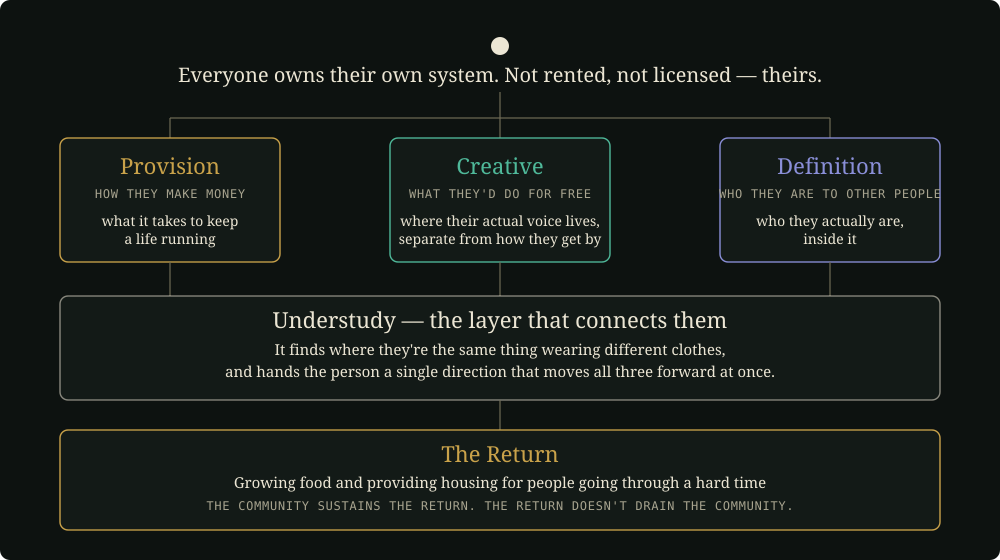
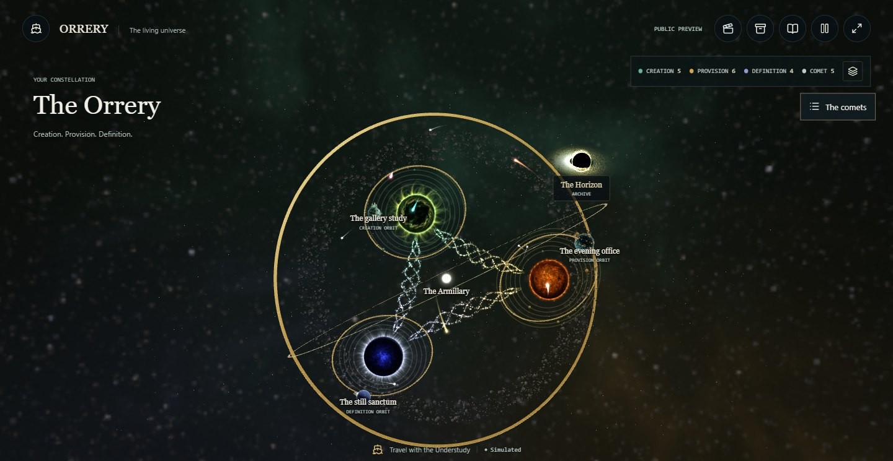
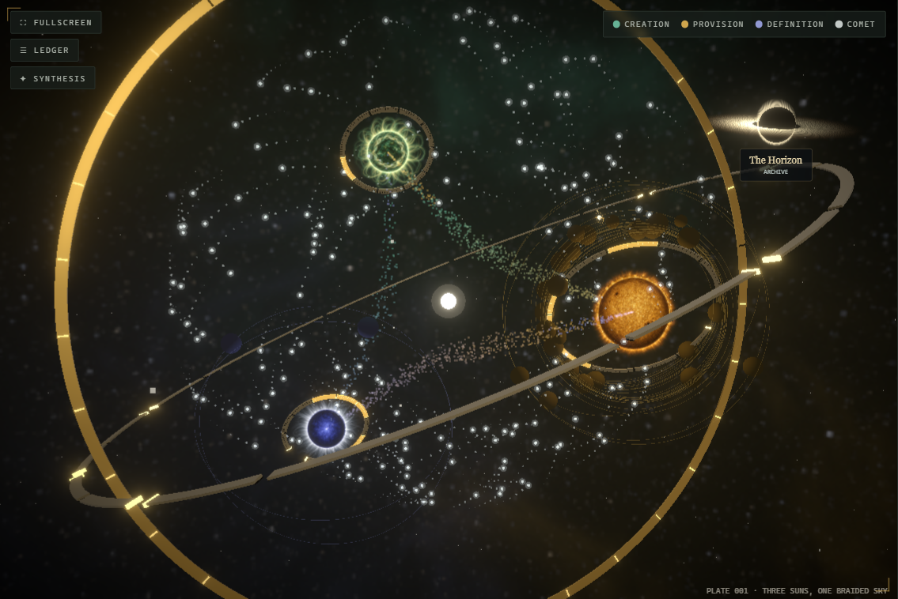
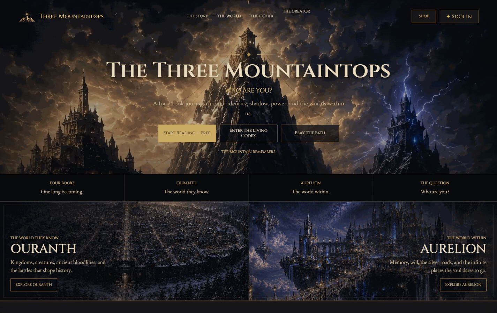

# Three Mountaintops

**Frank Epps** · systems integrator · [Understudy](https://understudy.consulting)

> **I am building to a point where I have a personal system that is unique to me, and a skeleton that anyone else can use to create a unique system for themselves.**

It points toward my north star:

> We build communities where every person owns a personal system that helps them provide for themselves, pursue what they love, and know who they are to the people around them — and we use what that makes possible to give people who've lost their footing the same tools to find it again.

Every person's system tracks three things at once: **Provision** (how they make money), **Creative** (what they'd do for free) and **Definition** (who they are to other people). **Understudy** is the layer that connects them. Everyone owns their own system: not rented, not licensed, theirs. This is the horizon, not a description of what exists yet. **[Read the whole North Star, in my words](work/north-star.md)**.

## See it

**Fly through it yourself: [voyage.understudy.consulting](https://voyage.understudy.consulting)** is the public edition of the Orrery, the system I am building this with, made for anyone to explore. Each mountain is a world you can enter, with illustrative data in place of the private system. Below is the private Orrery it is drawn from.

## Three Mountaintops World: my own platform

> my own platform I made. Complete with merch sales. That I built myself.
>
> *Spoken, 2026-11-21.*

My four-book series shares its name with the north star; it is the project on the Creative mountain. I built the platform around it: a reading site and living codex, an open discussion hub (the Gathering), films, a game (The Path), a member portal with a tier-filtered lore chat, and a merch shop. I write every word of the books myself; the case study covers only the platform.

- **Live:** [threemountaintops.world](https://threemountaintops.world) (site, codex, films, gallery, the Lane shop) and [the Fourthwall store](https://three-mountaintops-shop.fourthwall.com) it links to for checkout.
- **Member-gated:** [path.threemountaintops.world](https://path.threemountaintops.world), the game (top Patreon tier; the free public beta ended 2026-10-16).
- **Honest status:** the Gathering forum is built but did not load for visitors on 2026-11-21, because its database backend was unreachable.

**[Read the case study](work/three-mountaintops-world.md)**.

## Who is building it

I spent more than ten years in hardware: the U.S. Air Force, then integration engineering at Blue Origin (New Shepard, BE-4 / Vulcan, New Glenn), then eVTOL aircraft and humanoid robots. In all of it, a system that fails quietly is not acceptable. I now build AI systems to the same standard: **they say what they cannot prove.** I run [Understudy](https://understudy.consulting) (AI consulting and builds, and AI training for organizations). Open to AI-systems roles and contract work: **frank@marqueeweb.com**.

This repository is written for anyone who wants to know what I can build, technical or not. Each page starts in plain language and then goes under the hood. Live one-page site: **[sorry2befrank.github.io/portfolio](https://sorry2befrank.github.io/portfolio/)**

## Start here

- **Hiring for AI systems work?** [The Understudy](work/understudy.md) (an agent that earns each permission on a checked record), [engineering stories](work/engineering-stories.md) (what broke, what I measured, what I changed), and the public code in [knowledge-library](https://github.com/sorry2befrank/knowledge-library) (1,805 tests in CI).
- **Running a business?** [Client work](work/client-work.md), and [work with me](https://understudy.consulting/work-with-me.html) for builds and AI training.
- **Curious about the idea?** [The North Star](work/north-star.md), then [fly through Voyage](https://voyage.understudy.consulting).
- **Want to see a whole product I built and run?** [Three Mountaintops World](work/three-mountaintops-world.md), live at [threemountaintops.world](https://threemountaintops.world).

## The scale of it

| | |
|---|---|
| **43** repositories | roughly **1 million** lines of code (about 780k source, 295k tests) |
| **5,100+** commits in all, **4,300+** since 2026-07-04 | the great majority written by AI agents that I direct and check; see [the method](work/build-method.md) |
| **2,045** automated tests in the control system, run in full every night | the record shows 58 green, 15 red and 26 timeouts, and I publish it |
| **56** components, **8** layers, **11** governed workflows in one live system map | today, none is marked "verified" without a receipt |

Full table, with how every figure was measured: **[by the numbers](work/by-the-numbers.md)**.

## The work

| Case study | One line |
|---|---|
| **[The North Star](work/north-star.md)** | What I am building, the three mountains, and how the Knowledge Library becomes the memory. Start here. |
| **[Three Mountaintops World](work/three-mountaintops-world.md)** | The platform I built for my book series: reading site and codex, discussion hub, films, a Godot game behind a member gate, a tier-filtered lore chat, and merch. Live at [threemountaintops.world](https://threemountaintops.world). |
| **[The Orrery](work/orrery.md)** | A control room for a one-person AI operation: it maps every workflow, shows where each one is broken, does bounded work overnight, and refuses to say "working" without a receipt. |
| **[The Understudy](work/understudy.md)** | An AI agent that starts read-only and must earn every permission on a record checked by someone else. 208 reports, 150 adjudications, 0 confirmed-false, and a ladder it cannot skip. |
| **[Agent runtime](work/agent-runtime.md)** | Many agents for many customers, with no cross-customer reads, one metered model client and no path to production without a human. Safety rules are tests that are shown to fail. |
| **[Knowledge Library](work/knowledge-library.md)** | A search archive for AI assistants where nothing leaves the working set without a verified copy. Public, MIT licensed, 1,805 tests in CI. |
| **[Voyage](work/voyage.md)** | A connected AI system you can fly through, live on the web, with a public site that provably contains none of the private system. Plus a VR edition. |
| **[Production studio](work/production-studio.md)** | Story in, consistent finished media out: multi-model routing with visible cost, an identity lock for characters, and a safe bulk publish gate. |
| **[Authors Codex](work/authors-codex.md)** | A private workspace for novelists with authors isolated by the database schema itself: 21 tables, all with row-level security. |
| **[Client work](work/client-work.md)** | Rescuing a live client app by fixing the data-state cause, and building an astrology product checked against NASA reference data. |
| **[Smaller tools](work/tools.md)** | An offline business-audit app (public), a read-only notes server for AI apps, and rules for using a small judgment model. |
| **[The build method](work/build-method.md)** | The two-model build loop, independent verification, and the rules I wrote after things went wrong. |
| **[Engineering stories](work/engineering-stories.md)** | Fourteen times something broke, what I measured, and what I changed. |

## The five habits behind all of it

1. **"Unknown" is the default.** A step is verified only when a receipt says so.
2. **The builder never grades its own work.** A second agent, or a deterministic check, decides.
3. **Safety rules are tests.** If the rule can be broken without a red build, it is not a rule.
4. **Make mistakes reversible; keep the irreversible shut.** Writes are revert-protected; deploys are never automatic.
5. **Publish the uncomfortable numbers.** Every case study ends with its limits.

## How to read this repository

- **Not technical?** Read the first two sections of any case study, "In plain language" and "By the numbers".
- **Hiring or vetting?** Start with [engineering stories](work/engineering-stories.md) and [the method](work/build-method.md); they show judgment under failure.
- **Engineer?** Each case study has the mechanism and the decisions with their reasons.

## What is not here

The private systems have no public source, so this is written, not code, apart from the two public repositories linked above ([knowledge-library](https://github.com/sorry2befrank/knowledge-library) and [understudy-audit](https://github.com/sorry2befrank/understudy-audit)). Client and customer names, revenue and private writing are deliberately left out. Every figure was recomputed from the real systems on 2026-11-20; figures I could not verify are marked, not quoted.

## Contact

Open to AI-systems roles and contract work. Email **frank@marqueeweb.com**, or see [Understudy](https://understudy.consulting).

---

### About the site in this repo

`index.html` is the one-page site (inline CSS and JavaScript, no build step; the only external request is Google Fonts) and `img/` holds cleaned screenshots of the real systems, with private details cropped or blurred. It is hosted on GitHub Pages from the default branch root. To view it locally: `python -m http.server 8000` and open `http://localhost:8000`.
