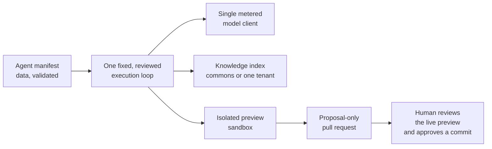

# Agent runtime: many agents, many customers, no unsafe path to production

*Case study. Two private repositories; the numbers below were recomputed on 2026-11-20.*

## In plain language

If you run AI agents for several customers, three things go wrong in predictable ways: an agent built for one customer reads another customer's data, a runaway agent spends without limit, and an agent that can edit a customer's app eventually edits it in production when no one is looking.

This runtime is built so those three failures are structurally hard, and so the claim "it cannot do that" is backed by a test that fails if someone makes it possible.

## How it works

- **Agents are data.** An agent is a manifest (configuration) run by one fixed loop. The manifest is validated, and any invalid one throws. The prompt path is confined to a prompts folder, tools and context builders come from closed lists, steps are capped at 100, and a "certified" manifest must record who certified it and when.
- **One metered client.** Only one file contains the model API address. It refuses a call unless tenant, agent and turn type are labelled, and it prices cached tokens. A test fails if any other file can reach the API.
- **Tenant-scoped knowledge.** Each piece of knowledge is either in the shared commons or in one tenant's own scope. A lookup for one customer cannot draw on another's.
- **Preview sandbox.** Generated apps run in an isolated sandbox (E2B, 600-second lifetime, a network allowlist of two hosts) that never touches a customer's repository.
- **No deploy path.** The code that opens a pull request says what it is: it never merges, and the ref update is sent with `force: false`. The PR body states that a human must review and merge it.
- **A separate execution layer** (second repo): a stable API contract with swappable backends. Commands are argument arrays only; there is no shell-string endpoint. Sandbox lifetime is capped at an hour with a reaper. The paid live test is skipped unless explicitly enabled.

## Rules that are tests

The safety rules are written as **"constitution" tests**, 13 law files. Each rule is shown to be able to fail: a script breaks the code in a temporary copy (for example, making the editor commit straight to production) and checks that the matching law goes red. The merge-gate law also tests the other direction: that a legitimate approval **does** publish, because a gate that refuses everything proves nothing.

The README admits that this mutation check "is gameable". I left that sentence in on purpose.

## By the numbers

| What | Value | Source |
|---|---|---|
| Runtime commits | **329** on the default branch (2026-06-15 to 2026-10-16) | GitHub API |
| Engine code | 115 JavaScript files, 19,433 lines | `wc -l` |
| Tests | 597 test declarations in 103 files; a targeted run of the manifest, tools, merge-gate and metering suites was **19 of 19 passing** on 2026-11-20 | static count plus run |
| Constitution tests | 13 law files, 14 mutators that prove they can fail | counted |
| Execution layer | 5 commits, about 840 lines of source, 28 test declarations | counted |

**What I have not verified:** a full-suite pass count for the runtime (there is no recorded result and I did not run it for this page), so I do not quote one.

## Decisions and why

| Decision | Why |
|---|---|
| Agents are manifests, tools are fixed | Behavior differs per customer without per-agent generated code to review. |
| Personalization lives in the knowledge namespace | The code path is identical for everyone; only the data differs. |
| A forge that can only propose | Nothing reaches production without a human reading the live preview. |
| Safety as executable tests | A rule that is only a document gets forgotten; a rule that fails the build does not. |

## Limits

- The execution layer's CPU and memory fields are *not* provider-enforced quotas (the README says so). It is extra operating surface that only pays for itself if code execution is sold as a service.
- Customer details are private and not described here.

## Related

[Understudy](understudy.md) · [Engineering stories](engineering-stories.md)
