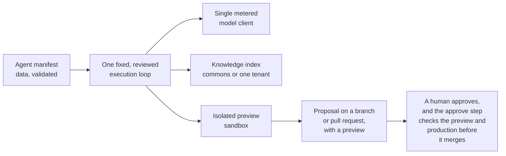

# Agent runtime: many agents, many customers, no unsafe path to production

*Case study. Two private repositories; the numbers below were rechecked on 2026-11-23 against each repository's default branch. AI coding agents (Claude Code and Codex) wrote most of this code under my direction.*

## In plain language

If you run AI agents for several customers, three things go wrong in predictable ways: an agent built for one customer reads another customer's data, a runaway agent spends without limit, and an agent that can edit a customer's app eventually edits it in production when no one is looking.

This runtime is built to make those three failures hard: each agent has a step cap and every Claude call in the engine goes through one labelled, metered client; each piece of knowledge belongs to the shared commons or to one tenant; and nothing the site editor or the Forge makes reaches a production branch without an explicit approval. For the metering, tenant and approval rules, the claim "it cannot do that" is backed by a test that fails if someone makes it possible.

## How it works

- **Agents are data.** An agent is a manifest (configuration) run by one fixed loop. The manifest is validated, and any invalid one throws. The prompt path is confined to a prompts folder, tools and context builders come from closed lists, steps are capped at 100, and a "certified" manifest must record who certified it and when.
- **One metered client.** Only one file in the engine contains the Claude API address. It refuses a call unless tenant and agent are labelled, checks the turn type (defaulting to "task"), and records each call's cost, including cached-token pricing. A test fails if any other engine file contains that address; it is a text scan of the engine folder, not a network block, and it does not cover the scripts folder.
- **Tenant-scoped knowledge.** Each piece of knowledge is either in the shared commons or in one tenant's own scope. A lookup filters to the allowed scopes before it ranks anything and adds only the caller's own tenant scope, and a law test checks that one tenant's lookup returns none of another tenant's rows. Which scopes a caller may ask for is decided by the layer in front of the lookup.
- **Preview sandbox.** Generated code runs in a disposable E2B sandbox (600-second default lifetime) that never touches a customer's repository. Modules the Forge writes get a network allowlist of two hosts (the npm registry and GitHub) and an empty environment. On the founder-site preview path, generated HTML is checked first and rejected if it loads outside scripts or stylesheets or contains any web address.
- **An approval-gated deploy path.** The code that opens a Forge pull request (against the engine's own repository) never merges, sends the ref update with `force: false`, and writes in the PR body that a human must review and merge it. The site editor does have a path to production, and Forge work can be published through it too: its approve step merges only after an explicit approval, only from its own preview or Forge branches, only if the preview answers with HTTP 200, and it refuses as stale if production has moved since the preview recorded it. Each merge is written to a ledger, and undoing one makes a new commit rather than a force-push.
- **A separate execution layer** (second repo): a stable API contract with a one-line seam for swapping backends. Only the E2B backend is implemented; the gVisor and Firecracker backends are stubs. Commands are argument arrays only; there is no shell-string endpoint (the E2B adapter quotes each argument before it hands the provider its command string). Sandbox lifetime is capped at an hour, and a reaper destroys any sandbox past its time. The paid live test is skipped unless explicitly enabled.

## Where it runs: the founder console

The runtime lives inside my campaign engine: one Node and Express service on Render that also queues the social posts for my book series. Understudy code entered that service on 2026-06-24 with a quote endpoint, and the founder console followed on 2026-07-06. The commit and test counts below cover that whole repository; the code count covers its engine folder.

The console is a private AI teammate page for each founder client.

- **Access.** A founder signs in with an access code that is checked against that founder's own salted hash with a timing-safe comparison. Each code can be revoked on its own, and the shared fallback code was removed.
- **Encrypted at rest.** Conversations, plans, ideas, escalations, change requests and referrals are sealed with AES-256-GCM on the server's disk. A missing key throws, so nothing is written in plain text, and a tampered record fails to open. The module that does this opens with my promise to founders, word for word: "Founders own their data completely: encrypted at rest, one-click export, real hard delete, and an explicit 'never used to train models' statement."
- **Requests become work.** Hidden markers in the model's reply turn a request into a structured record. Change requests land in a password-protected queue, and a script on my PC pulls new ones every 10 minutes into that founder's local folder as a build order.
- **Edits are gated in code, not in the prompt.** For a site with editing turned on, an edit becomes a preview branch and a Vercel preview, and each kind of edit passes its own code gate first. For a larger structural edit, every `<script>`, every `<form>` and every line with price, payment or checkout words must survive byte for byte, and the edit may not add scripts, frames, objects, embeds, forms, inline event handlers, `javascript:` links, meta refreshes or new outside addresses. Publishing then goes through the approval-gated path above.

**What went wrong.** The console launched before founder encryption did (2026-07-10), so some founder content was first written in plain text. A one-time migration on the production disk on 2026-07-11 found six plain-text rows, sealed them, read each one back through the real decoder, and removed the backup copies.

## Rules that are tests

The safety rules are written as **"constitution" tests**, 13 law files. Each rule is shown to be able to fail: a script breaks the code in a temporary copy (for example, making the editor commit straight to production) and checks that the matching law goes red. The merge-gate law also tests the other direction: that a legitimate approval **does** publish, because a gate that refuses everything proves nothing.

The README admits that this mutation check "is gameable": it proves that an assertion is wired, not that the assertion is wise.

## By the numbers

| What | Value | Source |
|---|---|---|
| Engine commits (the whole campaign-engine repository) | **329** on the default branch (2026-06-15 to 2026-10-16) | git history |
| Engine code | 125 JavaScript files, 24,102 lines in the engine folder | `wc -l` on the default branch |
| Tests | 800 test declarations in 122 files | static count on the default branch |
| Constitution tests | 13 law files, 14 mutators that prove they can fail | counted |
| Execution layer | 5 commits (2026-07-12 to 2026-07-20), about 1,130 lines of source, 24 test declarations in 5 files | counted |

**What I have not verified:** a pass count for either repository. The test numbers above are static counts of test declarations, and I did not run the suites for this page, so I do not quote a pass rate. I also did not check the layer in front of the knowledge index that decides which scopes each caller may request.

## Decisions and why

| Decision | Why |
|---|---|
| Agents are manifests, tools are fixed | Behavior differs per customer without per-agent generated code to review. |
| Personalization lives in scoped knowledge and per-tenant config | The founder console and the knowledge layer run the same code for every founder; scoped knowledge, a per-tenant console config and a site card shape the differences. The exception is a barbershop client with its own 18-file module set, which a guard routes to its own handlers. |
| A forge that can only propose | The Forge never merges its own work. What it and the site editor make reaches production only after a person approves it, and the approve step first checks the preview. |
| Safety as executable tests | A rule that is only a document gets forgotten; a rule that fails the verify run does not. |

## Limits

- The execution layer's CPU and memory fields are *not* provider-enforced quotas (the README says so). It is extra operating surface that only pays for itself if code execution is sold as a service.
- Metering records what each Claude call costs; it does not stop spending, and the model client has no request timeout or retry.
- The approve step checks that the preview answers with HTTP 200. It cannot prove that a person actually looked at the preview, and the pre-ship verifier is advisory: if it fails, it only logs a warning.
- Only two agent manifests are committed, so "agents are data" is the architecture, not yet a large fleet.
- There is no CI in the engine repository. The tests and the mutation check are run by hand or by an agent before a push.
- Customer details are private and not described here.

## Related

[Understudy](understudy.md) · [Engineering stories](engineering-stories.md)
