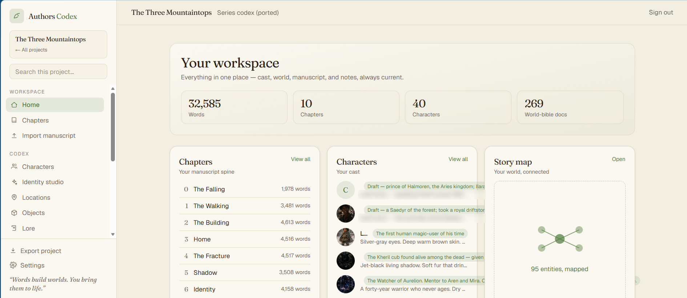

# Authors Codex: a private workspace for novelists, with privacy enforced in the database

*Case study. Live: [authors-codex.vercel.app](https://authors-codex.vercel.app). Source is private. Numbers recomputed 2026-11-20.*

## In plain language

A novelist's material is scattered: the manuscript in one file, characters in another, a map on paper, art in a folder. Authors Codex puts it in one place and **links it**: a character knows which chapters mention them, a place knows which events happen there. It is private by default, AI help is optional and structured, and the whole project exports as one portable file.

## How it works

- Next.js, React, TypeScript, Tailwind, and Supabase (Postgres, authentication and storage), with a graph view for the story map and the Anthropic SDK for the AI intake.
- **One universal entity model**: characters, places, events and chapters are all entities with typed links between them.
- **Isolation is in the schema, not just the app.** Every table has row-level security (RLS) on, and every child row uses a **composite foreign key** `(parent_id, author_id)` to a parent that is unique on `(id, author_id)`. A row cannot even reference another author's row, whatever the application code does.
- A denormalized `author_id` on every row makes the RLS check a cheap equality test.
- **AI intake is structured**, not free-form chat, and can be switched off.

## By the numbers

| What | Value |
|---|---|
| Tables | **21, all with RLS enabled** |
| Policies | 21 table policies plus 4 storage-object policies (25) |
| Cross-author guards | 20 `unique (id, author_id)` constraints and 38 composite foreign keys |
| Database | 11 migrations, 884 lines of SQL, 4 functions, 21 triggers, 50 indexes |
| App | 23 pages, 6 route handlers, 118 TypeScript files, about 17,500 lines |
| History | 83 commits (2026-05-30 to 2026-08-15) |

## What I did not do

**There are no automated tests in this repository**, and I do not claim any. Isolation is enforced by the schema and checked by a local verification script, but there is no automated RLS test suite. If I were taking this to paying users, writing one would be the first job.

## Decisions and why

| Decision | Why |
|---|---|
| Tenant isolation by schema (composite keys) | Application bugs cannot cross an author boundary the database refuses to represent. |
| Private by default | A writer's drafts are the most sensitive thing they own. |
| Structured AI intake | Predictable output beats an open-ended chat for building a bible. |
| Whole-project JSON export | Writers should never be locked in. |

## Related

[Production studio](production-studio.md) · [Client work](client-work.md)
