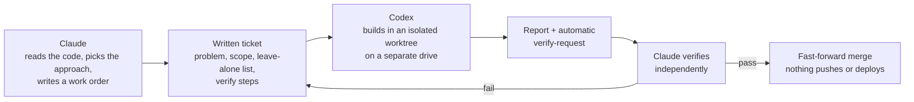

# The build method: how one person ships this much, and keeps it honest

*Method page. Counts were recomputed on 2026-11-20; see [by the numbers](by-the-numbers.md) for how they were measured.*

## In plain language

Most of this code is written by AI agents. I want to be direct about that, because the interesting question is not "did a person type it" but **"how do you know it works?"** My job is to decide what is built, to design the checks, and to refuse to call something done until it has been verified by something other than the thing that built it.

## The two-model split

- **One model designs and verifies; another builds.** This is partly about cost (building is bulk work) and mostly about independence: **a self-review counts as zero independent reviews.**
- **A ticket is a written work order**: the problem (confirmed by whoever specified it), the build scope with frozen shapes, a "leave alone" list of files, and the verification steps (unit tests for each race, then the full suite, with commit hash and counts reported back). Design tickets open with *review first; build only on the owner's word*.
- **The queue enforces the rules.** Only a new design-to-build ticket from the designer runs; anything from another origin is parked for me. The builder runs with user configuration ignored, never auto-approving, web search off, no tool servers and the network off, inside a disposable worktree under a native sandbox. **A no-model "drill" proves the isolation holds before any build is admitted.**
- **Every finished build files a verify-request back automatically.** The merge is a fast-forward after a pass. Nothing pushes or deploys.
- 71 written tickets so far (65 to the builder, 6 back), plus 30 reports, 9 verification documents and 5 plans. 13 builds have gone through the automated queue, each paired with a verify-request.

## What independence caught

On 2026-10-09 a shared start-claim mechanism was reviewed adversarially over **six rounds by the same agent (53 findings, all fixed)**. The same day, the other agent's independent review found check-then-act races the six rounds had missed: two starters could both win across a slot boundary, a renewal could succeed while another held the claim, a backward clock blocked starts. It was fixed and the shipped design went beyond the ticket. Repeating a review with the same reviewer is not the same as a second reviewer.

## Verification gates

- **The command:** a type-check, then the full test suite, run one test at a time. The Orrery suite is 201 files and **2,045 tests** (it was 348 in August).
- **A full run every night**, appended to a log. Across 99 recorded runs: **58 green, 15 red, 26 timeouts.** I publish that ratio because a method that only shows its green runs is marketing.
- **Receipts and trace IDs** for every operation (9,504 receipts across 3,124 traces), a **claim cross-check** (540 claims checked over 108 runs, 537 verified), and a 7-criterion clean-night gate (57 of 89 nights pass).
- **Red-team rounds.** Seven rounds of adversarial review produced **83 findings closed, 2 declined with a written reason, 0 open** (the seventh round awaits re-review). Every fix has a regression test that fails on the previous commit.
- **Atlas audit.** An audit of the system's own headline claims found all 7 *misleading*: the numbers were exact and the framing was wrong. Seven of seven independent challengers agreed. That is the kind of finding the method exists to surface.

## My own custom skills and memory

I wrote 71 reusable skills for the agents (a skill is a written procedure an agent follows). A few, at capability level:

| Skill | What it makes the agent do |
|---|---|
| clean-room release | Publish something derived from a private system with none of the owner's information in it: a separate repo, a local-only private-name scan, synthetic fixtures. *This showcase was built with it.* |
| deploy and verify | A deploy is not done until the **new** build is proven to be the one serving. |
| verify, don't guess | Never state a fact that was not observed; report "unverified" honestly. |
| measure the cause first | Treat a stated cause as a hypothesis and measure it before building the fix. |
| local port identity | A listening port is not an identity; check what is on it before killing it. |
| Windows file surgery | Never inline multi-line edits; detect line endings; abort if an anchor is missing; validate after. |
| codex hand-off, unison build | How to write a work order, and how two peer builders cross-review on one board. |

The agents also keep a memory index of 63 standing rules I have set (for example, "verify each citation before acting", which came from an incident below).

## Stories that shaped the rules

- **A fabricated citation inherited into a commit.** An automated report cited an audit document for a grouping of 823 files. The cited lines named other folders, and the phrase appears nowhere in the document. My own review passed it into a commit message. The action was still right, but the citation was false. That became the standing rule: grep every cited file and line before acting.
- **Building began before the cross-review, and was stopped.** On an ambiguous "build this plan", a 12-agent build was launched; 13 minutes later I pointed out the other agent had not reviewed the plan. It was stopped within minutes, the main branch was untouched, and the rule now heads the hand-off protocol and is enforced in the queue.
- **A test red only inside the nightly chain.** Four tests were red for three nights but 603 of 603 passed alone; five investigators split on the cause. The two who actually set the run-ID environment variable reproduced the failure, and the two who "refuted" it never set it. The log was the tiebreaker.
- **A hard-coded count that cascaded.** A test hard-coded "crew length equals 5". When a sixth agent was added, the nightly test run went red every night and cascaded into a tripped circuit breaker.

More in [engineering stories](engineering-stories.md).

## What this method does not do

- It does not make the code *correct*; it makes failures **visible and attributable**. The nightly record above includes 15 red runs and 26 timeouts.
- It is built around one operator on one machine. The hand-off queue, the sandbox drill and the lanes are single-owner tooling.
- Counts of commits and lines include AI-written work, and I say so everywhere I quote them.
