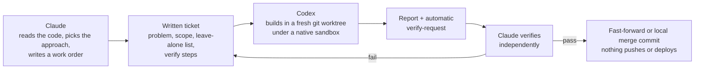

# The build method: how one person ships this much, and keeps it honest

*Method page. Counts were recomputed on 2026-11-20 unless a later date is given beside them; see [by the numbers](by-the-numbers.md) for how they were measured.*

## In plain language

Most of this code is written by AI agents. I want to be direct about that, because the interesting question is not "did a person type it" but **"how do you know it works?"** My job is to decide what is built, to design the checks, and to refuse to call something done until it has been verified by something other than the thing that built it.

## The two-model split

- **One model designs and verifies; another builds.** This is partly about cost (building is bulk work) and mostly about independence: **a self-review counts as zero independent reviews.**
- **A ticket is a written work order**: the problem (confirmed by whoever specified it), the build scope with frozen shapes, a "leave alone" list of files, and the verification steps (unit tests for each race, then the full suite, with commit hash and counts reported back). Design tickets open with *review first; build only on the owner's word*.
- **The queue enforces the rules.** A run starts only when the designer names the ticket, and a build runs only if the designer filed it for the builder; a build from any other origin is parked for me. The builder runs with user configuration ignored, its approval policy set to never, web search off, no tool servers and the network off unless the ticket asks for it, inside a fresh worktree under a native Windows sandbox. **A no-model "drill" proves the write limits and the network setting hold before any build is admitted.**
- **Every build attempt, failed ones included, files a verify-request back automatically.** After a pass bound to the exact commit, the merge is a fast-forward or a local merge commit. Nothing pushes or deploys.
- 71 written tickets so far (65 to the builder, 6 back), plus 30 reports, 9 verification documents and 5 plans. 13 builds went through the hand-off queue between 2026-10-10 and 2026-10-18, each paired with a verify-request; other work orders are relayed to the builder by hand.

## What independence caught

On 2026-10-09 the change that introduced a shared start-claim mechanism was reviewed adversarially over **six rounds by the same agent (53 findings, all fixed)**. The same day, the other agent's independent review found check-then-act races the six rounds had missed: two starters could both win across a slot boundary, a renewal could succeed while another held the claim, a backward clock blocked starts. It was fixed and the shipped design went beyond the ticket. Repeating a review with the same reviewer is not the same as a second reviewer.

## Verification gates

- **The command:** a type-check, then the full test suite, run one test file at a time. The Orrery suite is 201 files and **2,045 tests** (it was 348 in August).
- **A full run every night**, appended to a log. Across 102 recorded runs (2026-08-13 to 2026-11-23): **59 green, 16 red, 27 timeouts.** I publish that ratio because a method that only shows its green runs is marketing.
- **Receipts and trace IDs** (every nightly stage leaves one; 9,504 receipts across 3,124 traces), a **claim cross-check** (540 claims checked over 108 runs, 537 verified), and a 7-criterion clean-night gate (57 of 89 night records pass). That gate checks how the night ran and reported (silent exits, failures with no stated reason, claims with no evidence and similar checks), not whether the code is healthy: it does not read the test results, and on 35 nights it passed while that day's test run was red or timed out (counted 2026-11-23).
- **Red-team rounds.** On one build, the Orrery's observability layer in October 2026, seven rounds of adversarial review produced **83 findings closed, 2 declined with a written reason, 0 open**. A re-review of the seventh round on 2026-10-24 confirmed its fixes and found one more, which was then fixed. Every fix has a regression test that fails on the previous commit.
- **Atlas audit.** An audit of the seven flow-break diagnoses that the system's own Atlas showed on its Diagnostics page found all 7 *misleading*: every number was exactly reproducible, and every diagnosis pointed away from the true cause. All fourteen auditing agents, a verifier and an adversarial challenger for each diagnosis, agreed. That is the kind of finding the method exists to surface.

## My own custom skills and memory

My agents wrote 71 reusable skills under my standing rule that a solved problem becomes a skill, and I direct and review them (a skill is a written procedure an agent follows). That is the count in the 2026-11-20 backup; there were 72 by 2026-11-23. A few, at capability level:

| Skill | What it makes the agent do |
|---|---|
| clean-room release | Publish something derived from a private system with none of the owner's information in it: a separate repo, a local-only private-name scan, synthetic fixtures. *This showcase was built with it.* |
| deploy and verify | A deploy is not done until the **new** build is proven to be the one serving. |
| verify, don't guess | Never state a fact that was not observed; report "unverified" honestly. |
| measure the cause first | Treat a stated cause as a hypothesis and measure it before building the fix. |
| local port identity | A listening port is not an identity; check what is on it before killing it. |
| Windows file surgery | Never inline multi-line edits; detect line endings; abort if an anchor is missing; validate after. |
| codex hand-off, unison build | How to write a work order, and how two peer builders cross-review on one board. |

The agents also keep a memory index, 73 entries on 2026-11-23. Many are standing rules I have set; others are lessons the agents recorded after an incident (for example, "verify each citation before acting", which came from an incident below) and notes on the system's current state.

## Stories that shaped the rules

- **A fabricated citation inherited into a commit.** An automated report cited an audit document for a grouping of 823 files. The cited lines named other folders, and the phrase appears nowhere in the document. The reviewing agent passed it, and the false citation went into a commit message. The action was still right, but the citation was false. That became the standing rule: grep every cited file and line before acting.
- **Building began before the cross-review, and was stopped.** On an ambiguous "build this plan", the agent launched a 12-agent build; 13 minutes later I pointed out the other agent had not reviewed the plan. It was stopped within minutes, the main branch was untouched, and the rule is now the first coordination rule in the hand-off skill; design tickets open with it.
- **A test red only inside the nightly chain.** Four tests were red for three nights but 603 of 603 passed alone; five investigating agents split on the cause. The two who actually set the run-ID environment variable reproduced the failure, and the two who "refuted" it never set it. The log was the tiebreaker.
- **A hard-coded count, and a cascade that wasn't.** A test required the Executive's crew to have exactly five members. When a sixth was hired on 2026-08-21, the nightly test run went red three nights in a row. A circuit breaker tripped the same week, and Claude's first diagnosis tied the two into one cascade. Codex, investigating the same symptoms blind on 2026-08-24, showed from the run records that three unrelated crew failures had tripped the breaker, not the test. The test now checks crew contracts against a fixture roster instead of counting members.

More in [engineering stories](engineering-stories.md).

## What this method does not do

- It does not make the code *correct*; it makes failures **visible and attributable**. The nightly record above includes 16 red runs and 27 timeouts.
- It is built around one operator on one machine. The hand-off queue, the sandbox drill and the lanes are single-owner tooling.
- The builder's sandbox confines writes, not reads. That is a documented limit, accepted on purpose.
- A receipt's reason code is a label, not an explanation, and some labels are wrong: 385 "spend-refused" receipts were really delivery holds (counted 2026-11-23).
- Counts of commits and lines include AI-written work, and I say so everywhere I quote them.
