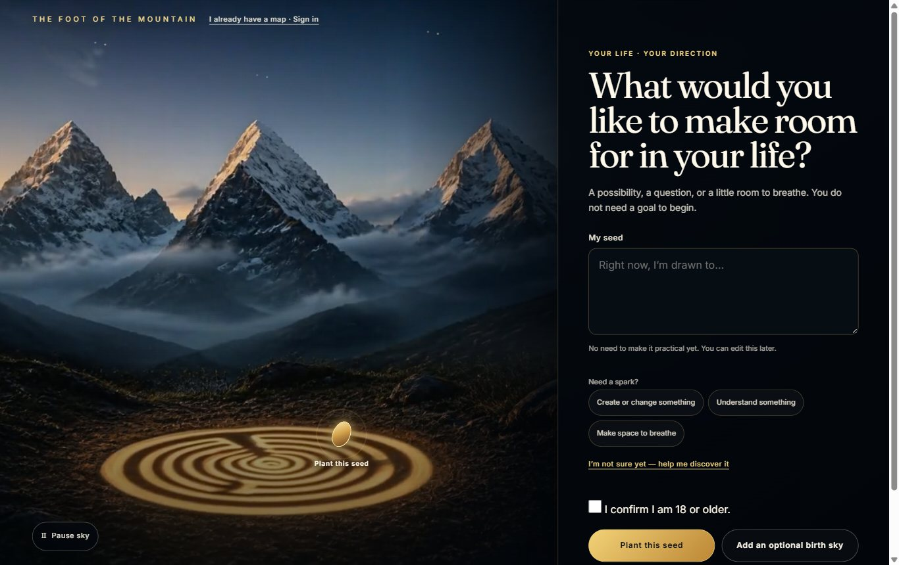
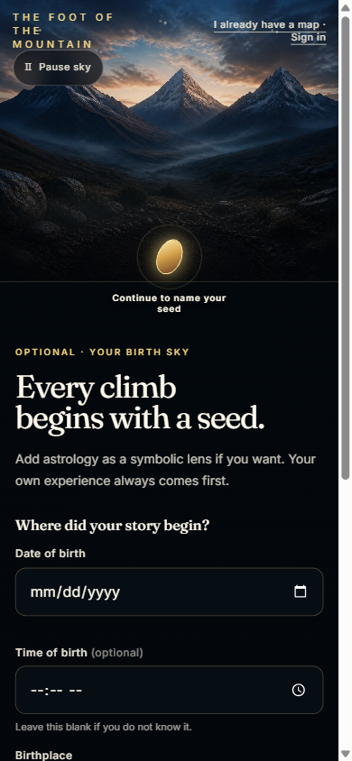

# Cosmic Blueprint: the seed for someone else's system

*Case study. Live: [www.cosmic-blueprint.org](https://www.cosmic-blueprint.org). Status, 2026-11-21: **live**, serving the main branch from 2026-09-09; no new commits since 2026-10-23. Source is private (the app and its separate front-end repository). Figures measured 2026-11-21. This page shows the machinery and the public first page only. I read no user data for it, and it lists no prices.*

> Cosmic Blueprint is the seed that I'm using in order to help someone else build their own personalized system that they can explore their own self in order to be successful in their regular day life.
>
> *Spoken, 2026-11-21.*

## The seed idea

The lead of this portfolio, in my words:

> I am building to a point where I have a personal system that is unique to me, and a skeleton that anyone else can use to create a unique system for themselves.
>
> *Spoken, 2026-11-20.*

My own system is called Michael. In my words: "It is my personal journal tracker that is personalized specifically to what I think is important and helps me track my goals and helps me achieve them, or helps me be able to have a reminder of what my tasks are. It's something that keeps me on par, and then there's a lot of different apps that have gotten integrated inside of it." (2026-11-21). Michael is built for one person and stays private.

Cosmic Blueprint is the other half: the same kind of system, offered to someone else, starting empty and growing from what they put in.

**The mechanism.** A visitor does not start from a template of my goals. They start from a seed of their own:

1. **A seed.** The first screen asks one question: "What would you like to make room for in your life?" No goal is needed.
2. **An optional birth sky.** Astrology is offered as a lens, not a verdict. The page says: "Your own experience always comes first."
3. **A place on the mountain.** A 24-item assessment places the person on three mountains and five stages. A terrain module maps their chart onto the same mountains.
4. **A map of their own.** Signed-in members get a navigation map: a profile, a brief for each mountain with its version history, and small experiments to try.
5. **A daily practice.** Goals, a journal, practices and progress check-ins, each with an optional AI reflection.
6. **A guide that remembers them.** One lasting conversation per person, with a memory store that the person can see and edit.

Each account holds only its owner's data, under database row-level security. The system belongs to the person using it, the way Michael belongs to me.

## What a visitor sees



*The public first screen at desktop width, 2026-11-21. Nothing was typed or submitted.*

The page opens on a full-screen painted mountain range at dusk, with a "living sky" video loop that the visitor can pause and a glowing labyrinth at the foot of the mountains. On the right: "What would you like to make room for in your life?" and "A possibility, a question, or a little room to breathe. You do not need a goal to begin."

- **My seed:** a free-text box ("Right now, I'm drawn to…").
- **Need a spark?** Three prompts: "Create or change something", "Understand something", "Make space to breathe". There is also "I'm not sure yet — help me discover it".
- **An age check:** "I confirm I am 18 or older."
- **Add an optional birth sky:** date of birth, an optional time and a birthplace, looked up through OpenStreetMap.



*The optional birth-sky step at phone width (390 px), 2026-11-21. On phones the "Pause sky" button sits over the header label.*

The page tells the visitor that only derived signs ever reach the Guide, never the date, time, city or coordinates. No account is needed to start, and a short free Guide conversation is included. The site installs as an app (a PWA, with a service worker and manifest).

## The parts

| Part | What it does | Built with | Status, 2026-11-21 |
|---|---|---|---|
| **Seed and birth sky** | The first screen above: a seed, spark prompts, an age check, an optional birth sky | Static front end, no build step | **Live**, public |
| **Chart generator** | Six tabs: Natal, Numerology, Vedic, Guidance, Daily, Transits. The natal chart is computed in the browser with a bundled ephemeris library and drawn as an SVG wheel. The Vedic layer applies its own date-accurate Lahiri ayanamsa and adds Vimshottari dasha and the Chinese zodiac. Pythagorean numerology, daily moon phase, transits and progressions | Browser JavaScript modules; the server checks the plan on every chart and AI call | **Live**, behind sign-in |
| **"Where Are You On The Mountain"** | 24 items scored into 5 stages and 3 mountains, saved per member with feedback for each stage | A pure scoring module plus two API routes | **Live**, behind sign-in |
| **Terrain** | Maps chart factors onto the three mountains. The module's own line: "Your chart is not your destiny. It is your terrain." | A pure function that never throws | **Live**, behind sign-in |
| **Navigation map** | A profile, a brief for each mountain with an archived version history, and small experiments. They are assembled into a "person context" the Guide may read, with consent | Behind a feature flag that is off unless set exactly | **Live.** The flag is on in production: its routes answer 401 to a signed-out request instead of the flag-off 404 |
| **AI Guide with memory** | A short taste for guests. For members: one lasting conversation, with history, chart context, mountain grounding, goals and checkpoints saved on the server. Members can list, add, edit and delete the memory items the Guide keeps. A separate one-shot reflective Guide uses a critic model and falls back to authored text | The Anthropic Messages API, called from the server only: Claude Haiku for chat, journal and goals; Claude Sonnet for the reflective Guide, with a Haiku critic | **Live.** Its routes answer 401 without a session |
| **Goals, journal, practices, progress** | Goals with an AI-suggested method, journal entries with an AI reflection, practice tracking with daily check-offs, progress check-ins with a rating and a reflection. Free members keep goals and practices without AI | API routes per feature, Supabase Postgres | **Live**, behind sign-in (the journal route answers 401 without a session) |
| **Plans and payments** | Three plans: free (the calculator math and the assessment, no AI), a one-time "Snapshot", and a subscription that unlocks the AI features. Payment is Stripe Checkout, a customer portal and a signature-verified webhook. The one-time purchase and the subscription are tracked separately, so cancelling one never removes the other | Stripe | **Built.** I made no purchase to test it |
| **Cost breaker and rate limits** | Before any AI provider call, the database does one atomic check-and-charge against global, per-member and guest daily budgets. A failed charge always denies the call. Per-member rate limits use a sliding window | Postgres functions; Upstash Redis | **Live** |
| **Birthplace lookup** | A proxy to OpenStreetMap's Nominatim with a one-request-per-second lease shared across server instances, and a cache keyed by a one-way hash of the city | One API route | **Live** |
| **Account deletion** | Removes billing state first, then the member's rows, then the sign-in account last, so a failure never leaves an account that can still sign in | One API route | **Built** |
| **Begin My Day** | A private morning ritual: one morning log, one message from an in-app companion persona named "Michael", one suggested practice. A lease and compare-and-swap rule stop a request from running twice | API route and front-end module | **Built and staged; not live.** It sits on a branch 3 commits ahead of main; production returns 404 for its route and script |
| **Front-end repository** | Holds exactly the files a browser receives, so the site can be previewed and edited without the backend. A sync script copies the app's public folder into it and never commits or pushes | A separate private repository | 2 commits, 81 files, last commit 2026-09-09 |

## How it fits together

```
   www.cosmic-blueprint.org  (static PWA on Vercel)
   seed . birth sky . chart generator . assessment . map . Guide
   chart engine runs in the browser
        |
        | derived values only; every AI call goes through the server
        v
   Vercel serverless API (24 routes)
     sign-in check -> plan check -> rate limit -> database charge
     -> Anthropic API
        |
        v
   Supabase Postgres + Auth
   (row-level security, owner-only)

   Stripe Checkout / portal --> signed webhook --> plan and entitlements
```

## How it relates to Michael

The two share ideas and one design, not code. Cosmic Blueprint does not connect to Michael or read any of Michael's data.

- **Michael to Cosmic Blueprint: the Guide design.** Michael's Guide works in four steps: gather, guide, discern (a critic checks the draft), deliver. The header of Cosmic Blueprint's `api/guide.js` says its Guide "ported *mechanism*" from Michael's Guide, rewired to this app's sign-in and plans. It also fails closed the same way: on a flag from the critic, a model error or a missing key, it returns the authored reflection instead.
- **The same stance.** Michael's design rule is "a mirror, not an oracle": it reflects and never gives verdicts, and what the person logs outranks any computed reading. Cosmic Blueprint's Guide carries the same rule: "A mirror, not an oracle — reflection and questions only, never prediction, fortune-telling, or a verdict about the person." The public page says it too: "Your own experience always comes first."
- **Cosmic Blueprint to Michael: a clean-room rebuild.** Michael has its own Blueprint section (12 route files: chart, numerology, Vedic, transits, compatibility and more). Its layout file calls it "the native replacement for Cosmic Blueprint (clean-room)". It runs its own Swiss Ephemeris engine rather than Cosmic Blueprint's library. A few of its AI prompts were folded in from Cosmic Blueprint, and one of its modules states "no Cosmic Blueprint code".
- **A room for it.** Michael's 3D Sanctum has a Cosmic Blueprint desk, next to the Interfaith Library.
- **"Michael" inside Cosmic Blueprint is only a name.** The staged Begin My Day ritual speaks as a companion called Michael. Its code is explicit: "There is deliberately no local journal store or connection to a Michael account."
- **The mountains.** The three-mountain assessment and map share the mountain image of my book series, [The Three Mountaintops](three-mountaintops-world.md). The Guide is kept out of the book's voice on purpose: its header says "NO book \"world-voice\"".

## Where the safety lives in the code

Three excerpts, verbatim.

**1. Plans gate the tabs, on the server.** `api/_lib/entitlement.js`, lines 26 to 31. The browser cannot unlock a tab; the server reads the member's plan on every chart and AI call. A separate chat allowlist means a client cannot pick the model, the system prompt or the tools.

```js
export const PLAN_TABS = {
  free:     ["natal", "numerology", "vedic"],
  snapshot: ["natal", "numerology", "vedic"],
  // Subscription = the AI tier: all six tabs.
  living:   ["natal", "numerology", "vedic", "guidance", "daily", "transits"]
};
```

**2. Birth data stays out of what is stored for the Guide.** `public/lib/calculator-snapshot.js`, lines 1 to 4. The snapshot that feeds the navigation map copies only derived values. A server validator checks its size and age, and the person-context builder never queries birth fields.

```js
// Pure, environment-neutral boundary between the browser calculators and the
// persisted navigation context. It deliberately copies only deterministic,
// PII-free derived values. Raw calculator inputs and generated prose never
// appear in the returned object.
```

**3. The free taste cannot fail open.** `api/guide-chat.js`, lines 14 to 16. Guests can talk to the Guide without an account, so that path is the one most open to abuse. Every guest call is charged against the guest budget and the global breaker in the same transaction, and any failure in that check denies the call.

```js
// Guest calls deliberately do not require authentication. Their transactional
// guest charge also charges the global breaker. Any guest-guard failure denies
// the provider call; the unauthenticated surface must never fail open.
```

## Privacy by design

- **Owner-only rows.** Personal data lives in Supabase Postgres under the member's own account. `schema.sql` has 46 row-level-security policies and turns security on for 17 tables; two later migrations turn it on for 3 more.
- **No client writes to the Guide's memory.** Conversations, memory and credits have no client write policy. Writes go through the server, and every server query is pinned to the signed-in member. Database triggers check that memory and reflection rows link only to their owner.
- **The guest preview stays in the browser.** A guest's goals and practices never call the API, and Begin My Day makes no calls for guests.
- **No secrets in the repositories.** Environment files are ignored by git. The public database key in the front end is public by design and protected by row-level security.

## By the numbers

| What | Value |
|---|---|
| Commits | 50 across all branches (2026-08-28 to 2026-10-23); 47 on main, ending 2026-09-09 |
| API | 24 endpoints, plus 13 shared server libraries; 6,511 lines of server code |
| Database | 10 SQL files: the schema plus 9 numbered migrations (v2 to v6, v9 to v12); 20 tables; 46 row-level-security policies in the schema |
| Front end | 21 JavaScript modules; `index.html` 3,624 lines, `mountain-app.js` 5,668 lines, `theme.css` 3,230 lines |
| Tests | 46 test files with 339 test cases, 7,214 lines. The deploy's build command runs the full suite, so a failing test stops a deploy |
| Assessment | 24 items, 5 stages, 3 mountains |
| Chart generator | 6 tabs on the live site |
| Front-end repository | 2 commits, 81 files, last commit 2026-09-09 |
| Live check | Four core files on the live site match main byte for byte (normalised SHA-1) |

The figures above are for main, the branch the live site serves. The staged Begin My Day branch adds 1 endpoint, 1 server library, 2 front-end modules and 4 test files with 38 more test cases (377 in all).

The test cases were counted, not run, for this page. The last recorded run, on 2026-10-23, was on the staged Begin My Day branch and passed all 377.

## Limits

- **I did not sign in for this page.** The chart tabs, the map, the Guide and the journal were checked in code and by their live routes (401 without a session), not by using them. The screenshots show only the public first screens.
- **Payments were not tested with a purchase.** The Stripe code is complete; I make no claim about live transactions.
- **Begin My Day is built and staged, not live.** Production returns 404 for it.
- **The repository SQL is not the whole database.** Four tables the API uses (journal entries, goals, progress check-ins and practice completions) are not created by any SQL file in the repository, and migrations v7 and v8 are not in it.
- **The tests were not rerun** for this page; the count comes from the test files.
- **Quiet since 2026-10-23.** The site is live and unchanged since the main branch of 2026-09-09.

## Related

[The North Star](north-star.md) · [Three Mountaintops](three-mountaintops-world.md) · [Build method](build-method.md)
