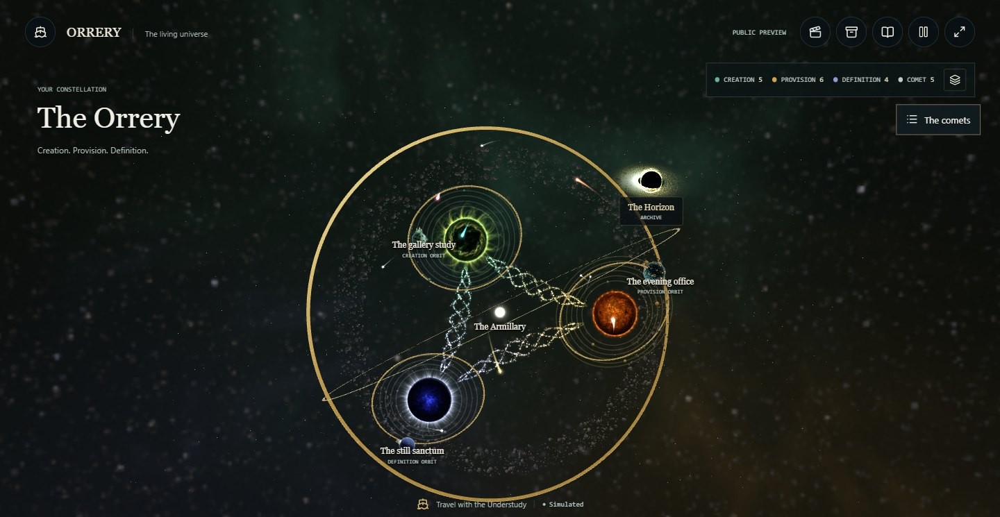
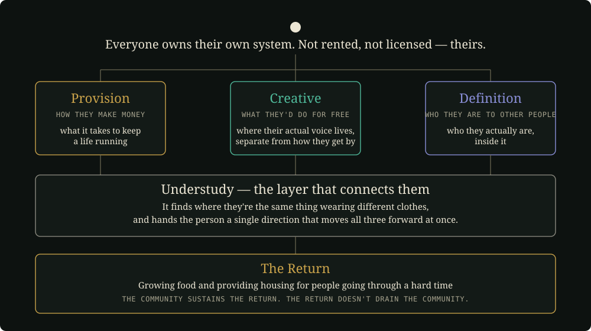

# The North Star

*Everything on this page is in my own words. Where a sentence was spoken rather than written, it says so. Nothing here describes a finished product: the North Star is the horizon, and the status of each part that runs today is at the end.*

## What I am developing

> **I am building to a point where I have a personal system that is unique to me, and a skeleton that anyone else can use to create a unique system for themselves.**
>
> *Spoken, 2026-11-20; lightly trimmed.*

> We are building something that doesn't exist. I am building a local system that will allow me to live my life in a way that is natural to me, with the projects that I'm interested in. This comes back to my three mountaintop concept: building something where I work on how I make money, what I'm creative about, and how I define myself as a person. And then building projects that are attached to that, so that I can roll them out with my own ownership.
>
> *Spoken, 2026-11-20; lightly trimmed.*

**See it before you read it:** [voyage.understudy.consulting](https://voyage.understudy.consulting) is the public edition of the Orrery, the system I am building this with. Anyone can fly through it. Each mountain is a world you can enter, with illustrative data in place of the private system.

## Three Mountaintops

*My north star, word for word.*

**We build communities where every person owns a personal system that helps them provide for themselves, pursue what they love, and know who they are to the people around them — and we use what that makes possible to give people who've lost their footing the same tools to find it again.**

### The system

Every person in the community has their own system — a personal agent, built around them, that grows as they do. It isn't generic. It's trained on how *they* think, and it tracks three things at once.

- **Provision — how they make money.** Bills, household, what it takes to keep a life running. The ground floor, not because it matters most, but because nothing else is possible without it.
- **Creative — what they'd do for free.** The thing they'd pursue even if nobody paid them. Where their actual voice lives, separate from whatever they do to get by.
- **Definition — who they are to other people.** How they affect the people around them, and how they hold onto themselves while doing it. Not who the community needs them to be — who they actually are, inside it.

Nobody climbs these one at a time. A shift in how someone earns changes what they have room to create, and what they create changes how people experience who they are. So the system tracks all three together, because in a real life they move together.

### Understudy — the layer that connects them

Above the three pillars sits **Understudy**: the part of the system that watches for the patterns underneath all of them — in how a person thinks, in what they keep circling back to, in the connections between what they'll do for money, what they'll do for free, and who they become in the doing.

> Understudy's job is not to manage three pillars separately. It's to find where they're **the same thing wearing different clothes**, and hand the person a single direction that moves all three forward at once.

### Ownership is the whole point

Everyone owns their own system. **Not rented, not licensed — theirs.** That single word is what separates this from every other tool a person is offered: it cannot be repriced, revoked, or switched off by someone else, and what it learns about them stays with them.

- **Parents** use their system to build curriculum for their own children — so kids grow up building confidence and a system of their own, instead of discovering all of this for the first time as adults.
- **Neighbours** use theirs to find each other: to build partnerships, strike deals, and spend money inside the community instead of outside it.
- **Entrepreneurs** who come up through this own their platforms and businesses outright. They aren't absorbed into one company — they work within the community, meeting the needs that show up around them.

The long arc is a community that thrives by each person operating in their own unrepeated way of thinking — not by conforming to one model of success, but by each person's system making their particular way of thinking legible enough to build a life on.

### The Return

A nonprofit sits alongside this and does one job: take what the community generates and funnel it into **growing food and providing housing** for people going through a hard time.

But the food and the housing are not the whole gift. The people inside them get access to *the same system everyone else has* — so they aren't just given shelter, they're given the same tool the rest of the community used to find provision, passion and identity in the first place. They find their own way back up, on their own time, with their own creativity. Not a programme's timeline. Not someone else's definition of "better."

> And nobody carries that weight alone, because the community already has cash flow moving through its own systems and its own businesses. **The community sustains the return. The return doesn't drain the community.**

### Where this stands today

This is the horizon the whole project points toward. It is **not** a description of what exists yet. Right now the nonprofit is not yet formed. Nothing has been raised.

## Each mountain's own north star

Each mountain in my own system has an agent, and each agent reads its north star at the start of every run. These are quoted from those files.

| Mountain | North star |
|---|---|
| **Provision** | "Make money that funds my lifestyle — in a way aligned with my principles — and build systems that track, automate, and evolve the ways I make it." The money exists to fund the lifestyle that frees me to climb the other two mountains. |
| **Creative** (its file calls it Creation) | "Write FOUR books ingrained with my own personal spiritual concepts — showcased through symbolism and allegory — and launch my own platform where people enjoy my creation, with picture visuals and community." The book is not the finish line; the platform and the people are. |
| **Definition** | Private, by design. |

The Creation file also carries a hard rule: the agent never drafts a line of the books. In the file's words, "Frank writes every word of the books himself; that is the whole point of the Creation pillar."

## How it is being built (status, not vision)

The parts below run today, or are designed, and each is marked honestly. More of the tools are in [Tools](tools.md) and [By the numbers](by-the-numbers.md).

A system that acts across someone's whole life has to say what it cannot prove, earn every permission, remember with sources, and keep each person's data apart. Those are the problems the rest of this portfolio works on:

| What the idea needs | What I built | Status today (2026-11-20) |
|---|---|---|
| Say what it cannot prove | **[The Orrery](orrery.md)**: maps my own system, shows where each part breaks, and refuses to say "working" without a receipt | **Running** every night; 2,045 tests. Today none of its 11 flows is fully verified, and it says so. |
| Earn every permission | **[The Understudy](understudy.md)**: starts read-only and earns each rung on a record someone else checks | **Running** at a limited rung; 150 adjudications, none confirmed false. Unattended repair has not landed yet. |
| Remember with sources | **[Knowledge Library](knowledge-library.md)**: decisions, specs and receipts saved with their source and cited instead of re-read | **Supervised pilot**: a private deployment since 2026-10-20; the public repository is a synthetic-data snapshot. The weekly cleanup cycle is designed, not built. |
| Keep each person's data apart | **[Agent runtime](agent-runtime.md)** (no cross-customer reads) and **[Authors Codex](authors-codex.md)** (row-level security on every table) | **Built**, private code. Authors Codex has no automated tests yet. |
| Keep the data with the person | **[understudy-audit](https://github.com/sorry2befrank/understudy-audit)**: an offline audit app whose edits stay on the device | **Live**, public code, 36 of 36 tests. |
| Let anyone see it | **[Voyage](voyage.md)**: the public edition you can fly through | **Live.** The VR edition is emulator-tested only. |
| Turn a story into media | **[Production studio](production-studio.md)** | **Built** and tested. |
| Ownership, today | | The data, memory and rules are mine and portable. The models are rented and swappable. |

## Related

[Three Mountaintops World](three-mountaintops-world.md) · [Tools](tools.md) · [By the numbers](by-the-numbers.md) · [Build method](build-method.md) · [Engineering stories](engineering-stories.md)
