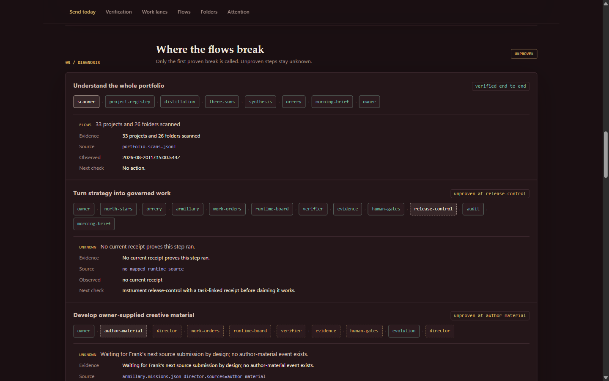
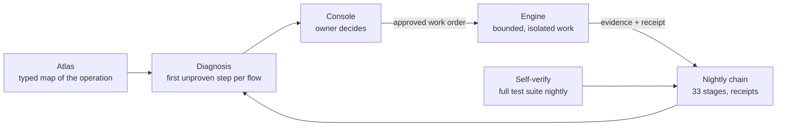

# The Orrery: a control room for a one-person AI operation

*Case study. No source code is published here; every number below was recomputed from the running system on 2026-11-20.*

## In plain language

I run several projects at once, with AI agents doing much of the work. The danger of that setup is not that the agents fail. It is that they fail **quietly**: a dashboard says "green", a nightly job reports "done", and nobody notices that a step in the middle never actually ran.

The Orrery is the system I built to prevent that. It does three jobs:

1. **Maps** the whole operation (every component, how they connect, which workflows depend on which).
2. **Shows me where each workflow is broken**, and refuses to say "working" unless there is a receipt that proves it.
3. **Does bounded work overnight** (small, isolated repairs and reports) and hands the results to me to approve.

The idea that runs through all of it: *"unknown" is the default, not "fine".* If the system cannot prove a step happened, it says so.

## What it looks like

## By the numbers

| What | Value | How it was measured |
|---|---|---|
| Commits on the live branch | **535** (2026-07-03 to 2026-11-18); 197 of them in the last 60 days | `git log --oneline \| wc -l` |
| Of those, with an AI co-author trailer | about 321 | counted from commit trailers; the rest are hand-made or merges |
| Tracked source | about 122,000 lines in 1,237 files (TypeScript/TSX, JavaScript modules, PowerShell, CSS; the files total includes data and docs); about 36,000 of those lines are tests | `git ls-files` plus `wc -l` |
| Automated tests | **2,045 tests: 2,043 pass, 0 fail, 2 skipped** across 201 test files (last full run 2026-11-20) | the system's own self-verify log |
| Atlas | **56 components, 8 layers, 104 connections, 11 governed flows** | counted from the atlas data file |
| Overnight chain | **33 stages**, run every night in the early morning; median run about 85 minutes | counted from the chain script and 119 recorded runs |
| Receipts written | 9,504 rows tied together by 3,124 trace IDs | counted from the receipt ledger |

A note on honesty: today's diagnosis shows **0 of 11 flows fully verified, 5 unproven and 6 blocked** (four of the six are waiting on a decision from me). That is the system working as designed. It would be easy to build a dashboard that shows all green; this one shows what it can prove.

## How it works

### 1. The Atlas and the Diagnosis (observe)

The Atlas models the operation as a typed graph: 56 components in 8 layers, with the flows that run through them. The **Diagnosis** walks each flow step by step.

- A step starts as `unknown`. It becomes proven only when a receipt exists for it.
- The first step that breaks marks everything after it `unreached`, so you see *where* a flow stops, not a wall of red.
- A human gate (a decision waiting on me) is a named stop, not an error.
- Snapshots carry an identity, so a stale snapshot cannot pass as tonight's.

Design decision: **stores hold facts, the Diagnosis holds relationships.** The Diagnosis does not re-derive facts; it checks whether the facts the stores claim are connected by proof.

### 2. The console (decide)

One place where everything that needs a human decision shows up. It is built as a *read-mostly* surface: a bounded snapshot per area, and each section that fails shows up as a named problem rather than a fake zero.

Writes are tickets and decisions. Sending messages and deploying stay with me.

**The Agency Console is the strictest example.** It is a separate local app (about 10,100 lines of TypeScript, 13 test files, 74 test declarations, 59 commits) that shows the decisions, pipeline, lanes and client relationships that need me. Its safety test **scans every runtime source file** and fails the build if any of them mentions mail transport, a child-process API, a git library, or a deploy, so the console is structurally incapable of sending or deploying. Its pipeline, lanes and clients adapters are tested for having no write primitive at all. (I verified that test by reading it on 2026-11-20; I did not re-run it for this page.)

The Orrery's own console is looser by design: it can start local, bounded work orders and persona runs (argument arrays, no shell), so I do not make the "cannot act" claim for it. Access is gated by a one-time pairing code (stored as an HMAC, 5-minute expiry) that issues an HttpOnly cookie, on top of host and origin checks. That pairing step was added after I proved, on my own network, that a device sending a forged origin header could reach it.

### 3. The engine (execute)

Turns approved intent into small work orders and runs them unattended:

- A **git worktree per attempt**, pinned to a known base, with a refusal list for files that look like secrets.
- A **default-deny write policy**. Tenants are identified by a marker file, not a folder name, because a rename would defeat a name-based list.
- Per-job caps (40 tool calls, 5 minutes), **circuit breakers scoped to a lane** (71 trips recorded, none global), and a spend ledger.
- A **jury**: a deterministic citation check can veto first; then a pairwise jury, with at least one non-Claude local model, judges the result. The local juror abstains on any failure, so it can only withhold approval, never grant it.
- For repairs: the model gets Read and Edit only. A wrapper owns git and tests, and it never merges or pushes. A human promotes.

Honest status: the unattended repair lane is built and guarded, but across 35 attempts it has **not yet landed a verified repair** (34 discarded, 1 in progress). I report that because the number is the point.

### 4. The nightly chain

33 stages run in causal order, not clock order. A per-stage watchdog kills a hung step. A reserve (110 minutes of a 4h45 budget) is held back so verification and reporting always run. Every stage writes a receipt with a trace ID. A night can end `complete-with-errors`, and it says so.

### 5. The honesty discipline

- **Terminal receipts**: a stage is done when a receipt says so, not when it stopped.
- **A 7-criterion clean-night gate** and **a full test run every night** (self-verify, 2,045 tests).
- **Cost figures are labelled estimates, not invoices.** Unmeasured spend is recorded as *unmeasured*, never zero (1,932 of 1,964 ledger rows are measured; 32 are labelled unmeasured).
- **Known gap I have documented rather than hidden:** the clean-night gate measures hygiene, not code health. On 2026-11-19 the test run was red while the gate passed. That is recorded as a defect to fix, not smoothed over.

### 6. The visual layer

A 3D "orrery": the three pillars of the work are suns, orbit radius shows recency, planet size shows activity, and finished work becomes black holes in an archive. A pure mapping function is unit-tested; source-scan tests keep the scene components free of network, file and process access; an SVG and reduced-motion fallback exists for accessibility.

### 7. The build loop with a second AI

I split building between two models: one designs, specs and verifies, the other builds in an isolated worktree on a separate drive under a native sandbox. A written ticket moves between them (65 tickets so far). A trusted dispatcher commits, not the model. See [the build method](build-method.md).

## Decisions and why

| Decision | Why |
|---|---|
| `unknown` is the default state, never green | A system that can say "I don't know" can be trusted when it says "verified". |
| The builder never verifies its own work | A model that scores itself drifts toward flattering itself. |
| Tools are removed from unattended agents, not just forbidden | A prompt is not a boundary. |
| Features ship dormant behind flags, byte-identical when off | A merge should not change behavior until I switch it on. |
| Archive by hash-verified copy and atomic replace, never hard-delete | Cleanup must be reversible. |
| The Orrery observes and routes; it never does another project's job | One owner per job keeps the failures attributable. |

## Stories from the build

Five of the episodes behind these numbers, with evidence, are in [engineering stories](engineering-stories.md). Example: a console that froze three times because every open tab polled a 12.9 MB snapshot every 4 seconds; the fix brought a poll down to 630 KB.

## Limits (what this is not)

- It is a single-owner system on one machine, not a multi-user product. It binds to localhost; a public deployment would need a deliberate upgrade first.
- The unattended repair lane has not yet landed a verified repair.
- 6 of 11 flows are currently blocked; four wait on my decision.
- There is no public source. This page and the screenshots are the public record.
