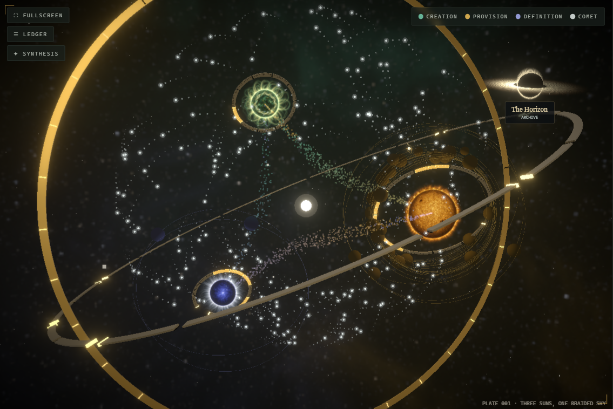
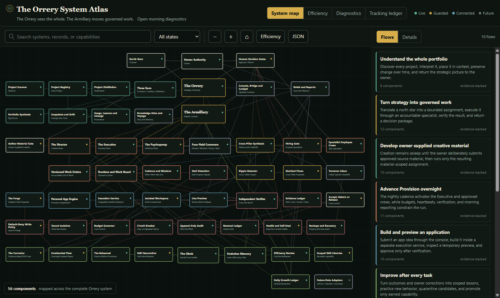
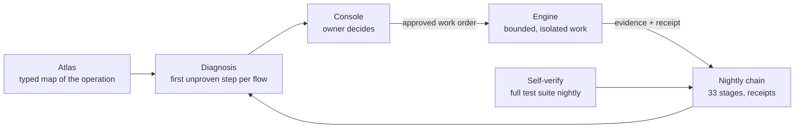

# The Orrery: a control room for a one-person AI operation

*Case study. No source code is published here; every number below was recomputed from the running system on 2026-11-20, except where a later date is given (a second check against the code and its records on 2026-11-23 updated those).*

## In plain language

I run several projects at once, with AI agents doing much of the work. The danger of that setup is not that the agents fail. It is that they fail **quietly**: a dashboard says "green", a nightly job reports "done", and nobody notices that a step in the middle never actually ran.

The Orrery is the system I built to prevent that. It does three jobs:

1. **Maps** the whole operation (every component, how they connect, which workflows depend on which).
2. **Shows me where each workflow is broken**, and refuses to say "working" unless there is a record that proves it.
3. **Does bounded work overnight** (small, isolated repairs and reports) and hands the results to me to approve. A few reversible lanes land without a click from me, each with an undo or a backup: for example, delivering a skill the jury has checked, or applying a confirmed correction to a document.

The idea that runs through all of it: *"unknown" is the default, not "fine".* If the system cannot prove a step happened, it says so.

## What it looks like

The living view: three suns for the three areas of work, every project in orbit (distance is how recently it was touched, size is how much work it holds), and finished work falling into an archive called the Horizon.

The working views: the map of components, and the diagnosis of where each workflow stops.

## By the numbers

| What | Value | How it was measured |
|---|---|---|
| Commits on the live branch | **535** (2026-07-03 to 2026-11-18); 197 of them in the last 60 days | `git log --oneline \| wc -l` |
| Of those, with a Claude co-author trailer | about 321 | counted from commit trailers. Trailers count commits, not lines of code; the rest include merges and work built by Codex, which this count does not capture |
| Tracked source | about 122,000 lines in 1,237 files (TypeScript/TSX, JavaScript modules, PowerShell, CSS; the files total includes data and docs); about 36,000 of those lines are tests | `git ls-files` plus `wc -l` |
| Automated tests | **2,045 tests: 2,043 pass, 0 fail, 2 skipped** across 201 test files (full run of 2026-11-20); by 2026-11-23 the suite had 2,213 tests in 216 files, with 2,211 passing and 0 failing | the system's own self-verify log |
| Atlas | **56 components, 8 layers, 104 connections, 11 governed flows** | counted from the atlas data file |
| Overnight chain | **33 stages**, run every night in the early morning; median run about 85 minutes | counted from the chain script and 119 recorded runs |
| Months of unattended running | **120 nights** between 2026-07-20 and 2026-11-20, missing 4 single nights; one planned shutdown (the evening of 2026-11-04, about four hours, for storage work) | the chain's run log, by night |
| Agent runs, unattended | **382 lead-agent runs and 1,465 crew-agent runs** across 187 nightly cycles, July to November | the cycle log |
| Overnight work orders | **225 created; 69 ran; 29 reached my review; I accepted 21** (most in August and September), as of 2026-11-23. After 2026-10-18 no new orders were filed until 2026-11-21, while I paused the Orrery's work to redesign it (its nightly checks kept running); six were filed on 2026-11-21, and three of those are waiting on my review. | the work-order log, final state per order |
| Receipts written | 9,504 rows tied together by 3,124 trace IDs | counted from the receipt ledger |

A note on honesty: the diagnosis on 2026-11-23 showed **0 of 11 flows fully verified, 5 unproven and 6 blocked** (three of the six are waiting on a decision from me). That is the system working as designed. It would be easy to build a dashboard that shows all green; this one shows what it can prove.

## How it works

### 1. The Atlas and the Diagnosis (observe)

The Atlas models the operation as a typed graph: 56 components in 8 layers, with the flows that run through them. The **Diagnosis** walks each flow step by step.

- A step starts as `unknown`. It becomes proven only when a runtime record (a receipt or a ledger row) shows it happened.
- The first step that breaks marks everything after it `unreached`, so you see *where* a flow stops, not a wall of red.
- A human gate (a decision waiting on me) is a named stop, not an error.
- Snapshots carry an identity, so a stale snapshot cannot pass as tonight's.

In AI terms this is **workflow observability**: rule-based checks, not a model-quality eval. Every night since late August it has checked each of the 11 flows against the runtime records and named the first step that broke. The Understudy's citation harness is a separate **check on agent output**: it opens every file and line an agent cites, and has rejected 22 of 210 reports ([details](understudy.md)). Neither is a benchmark suite with a fixed test set, and I don't call them one.

Design decision: **stores hold facts, the Diagnosis holds relationships.** The Diagnosis does not re-derive facts; it checks whether the facts the stores claim are connected by proof.

### 2. The console (decide)

One place where everything that needs a human decision shows up. It is built as a *read-mostly* surface: a bounded snapshot per area, and each section that fails shows up as a named problem rather than a fake zero.

Writes are tickets, standing directives and decisions. Sending messages and deploying stay with me.

**The Agency Console is the strictest example.** It is a separate local app that runs only on 127.0.0.1 and shows the decisions, pipeline, lanes and client relationships that need me. It is about 10,100 lines of TypeScript with 13 test files and 74 test declarations (3 of those files are so far only on a local side branch), and 4 commits touch it, from 2026-08-20 to 2026-10-02. Its safety test **scans every runtime source file** (every .ts, .tsx and .mjs file in its app, components and lib folders, plus the auth proxy) and fails the test run, the first step of the documented gate before a build, if any of them mentions mail transport, a child-process API, a git library, or a deploy. It is not wired into the build command itself, and it reads the console's own source text, not its dependencies or what it does at runtime: it guards the console's own code against send and deploy calls, but it does not prove the app can never send or deploy. Its pipeline, lanes and clients adapters are tested for having no write primitive at all. (I verified that test by reading it on 2026-11-20; I did not re-run it for this page.)

The Orrery's own console is looser by design: it can start local, bounded work orders and persona runs (argument arrays, no shell), so I make no such claim for it. Its actions are gated by a one-time pairing code (minted only on the Orrery PC, stored as an HMAC, 5-minute expiry) that issues an HttpOnly, SameSite=Strict cookie, on top of host and origin checks. By design, the read-only snapshot (counts, questions and the trust record) stays open to my home network. That pairing step was added after a live test on my own network on 2026-10-08 proved that a device on the Wi-Fi could forge the host and origin checks.

### 3. The engine (execute)

Turns approved intent into small work orders and runs them unattended:

- A **git worktree per attempt**, pinned to a known base, with a refusal list for files that look like secrets.
- A **default-deny write policy**. Tenants are identified by a marker file, not a folder name, because a rename would defeat a name-based list.
- A timeout on every crew run (12 minutes for a read-only run, 15 for a write run, with the whole process tree killed), **circuit breakers per lane plus a global one** (71 breaker events recorded through 2026-11-01; three lane breakers tripped, all on 2026-08-27 and all for timeouts), and a spend ledger.
- A **jury** in the Rehearsal, where agents practice on real blocked items: a deterministic citation check can veto first; then a pairwise jury, run in both orderings with at least one non-Claude local model, judges the result. The local juror abstains on any failure, and an abstention can never push a result through.
- For repairs: the model gets Read and Edit only. A wrapper owns git and tests, and it never merges or pushes. A human promotes.

Honest status: the unattended repair lane is built and guarded, but as of 2026-11-23, across 38 attempts, it has **not yet landed a verified repair** (37 discarded, and one never recorded a result). I report that because the number is the point.

### 4. The nightly chain

33 stages run in causal order, not clock order. A per-stage watchdog kills a hung step. A reserve (110 minutes of a 4h45 budget) is held back that only the final reporting stages can use. Every stage writes a receipt with a trace ID, including a stage that is skipped or held. A night can end `complete-with-errors`, and it says so: each of the six nights from 2026-11-18 to 2026-11-23 ended that way, with two stages (stale-audit and artifact-verify) failing every one of those nights.

### 5. The honesty discipline

- **Terminal receipts**: a stage is done when a receipt says so, not when it stopped.
- **A 7-criterion clean-night gate** and **a full test run every night** (self-verify, 2,213 tests on 2026-11-23).
- **Cost figures are labelled estimates, not invoices.** A cost that was never reported is recorded as *unmeasured*, never zero (on 2026-11-23, 2,240 of 2,252 settled runs had a measured cost; 12 are labelled unmeasured). One gap: a call that fails and reports zero tokens is recorded as a measured zero, so in the cost ledger 115 failed calls on 2026-11-08 to 11-10 look like cheap runs, not failures.
- **Known gap I have documented rather than hidden:** the clean-night gate measures hygiene, not code health. On 2026-11-19 the test run was red while the gate passed, and the same happened on 2026-11-21 (the test run timed out) and 2026-11-22 (one failing test). Counted on 2026-11-23, the gate has passed on 35 nights when that day's test run was red or timed out. That is recorded as a defect to fix, not smoothed over.

### 6. The visual layer

A 3D "orrery": the three pillars of the work are suns, orbit radius shows recency, planet size shows activity, and finished work becomes black holes in an archive. A pure mapping function is unit-tested; source-scan tests keep the scene components free of network, file and process access; an SVG and reduced-motion fallback exists for accessibility.

### 7. The build loop with a second AI

I split building between two models: one designs, specs and verifies, the other builds. A written ticket moves between them (65 to the builder so far). Through the hand-off queue (13 builds between 2026-10-09 and 2026-10-18), the builder works in an isolated git worktree outside the main checkout, under a native Windows sandbox, and a trusted dispatcher commits, not the model; other tickets are relayed to the builder by hand. See [the build method](build-method.md).

## Decisions and why

| Decision | Why |
|---|---|
| `unknown` is the default state, never green | A system that can say "I don't know" can be trusted when it says "verified". |
| The builder never verifies its own work | A model that scores itself drifts toward flattering itself. |
| Tools are removed from unattended agents, not just forbidden | A prompt is not a boundary. |
| Features ship dormant behind flags, byte-identical when off | A merge should not change behavior until I switch it on. |
| Archive by hash-verified copy and atomic replace, never hard-delete | Cleanup must be reversible. |
| The Orrery observes and routes; it never does another project's job | One owner per job keeps the failures attributable. |

## Stories from the build

Five of the episodes behind these numbers, with evidence, are in [engineering stories](engineering-stories.md). Example: a console that froze three times because every open tab polled a 12.9 MB snapshot every 4 seconds; the fix brought a poll down to 630 KB.

## Limits (what this is not)

- It is a single-owner system on one machine, not a multi-user product. It runs as a local development server (`next dev`) on my home network, so my phone can reach it over Wi-Fi as well as the PC. It is a home-network tool, not hardened for the internet; a public deployment would need a deliberate security upgrade first.
- The unattended repair lane has not yet landed a verified repair.
- On 2026-11-23, 6 of 11 flows were blocked; three of those wait on my decision.
- There is no public source. This page and the screenshots are the public record.
