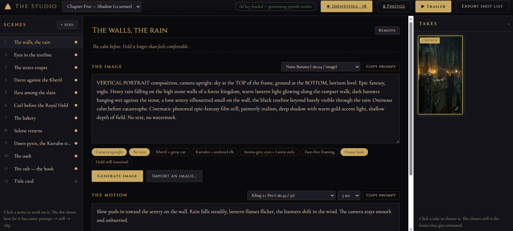
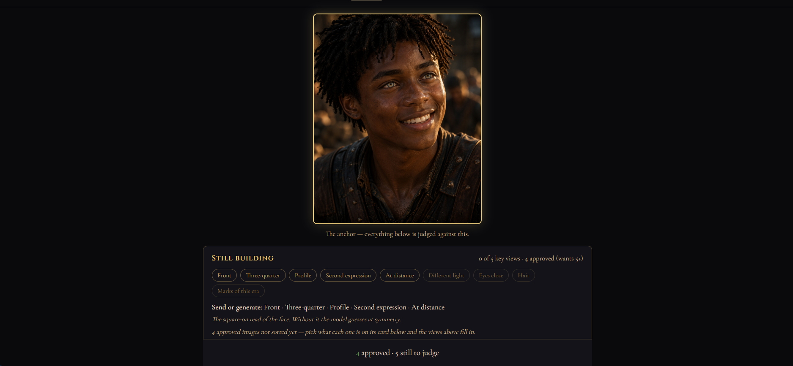
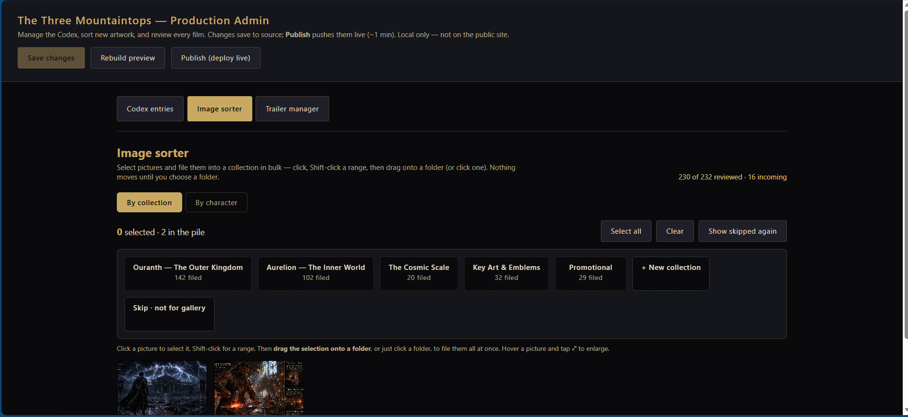

# Production studio: story in, consistent finished media out

*Case study. Source is private. Live output: [threemountaintops.world](https://threemountaintops.world). The story and its world are my own narrative project and are not described here, only the machinery. As with the rest of my work, AI coding agents (Claude Code and Codex) wrote most of the code under my direction.*

## In plain language

Generating one good AI image is easy. Generating hundreds that all show the **same character in the same world**, at a known cost, and then sorting and publishing them safely, is an engineering problem. I built the pipeline for my own narrative project, which has a world, a cast of characters and many locations.

## Three tools in one system

### 1. The Studio: story to shots to finished media

Flow: story, then shots and takes, then approve, animate, lock and export a shot list. Approved clips are stitched with ffmpeg crossfades.

- **Model routing is data.** Six image routes (two manual hand-offs, four through APIs) and three video routes live in one configuration file. Each model's cost shows in the selector before you click generate.
- **A guardrail in the server.** If a prompt packet carries a warning (for example, reference art being sent to a model that cannot accept it), the server returns HTTP 409 and refuses to generate.
- On 2026-11-23, on the working branch: 12 tracked project files (plus 1 untracked) holding 109 shots; 151 commits touching the studio (2026-08-09 to 2026-11-21); 2,318 lines for the server, phone gateway, assembler and library, or 5,034 with the browser UI (raw line counts); 50 unit tests in 6 studio test files, 92 more in 23 test files for its scripts, and 9 browser test scripts.

### 2. The identity lock: the same face, every time

Every character has a review set with **one approved anchor image** that is never offered as a candidate. Each additional view is judged against it. A coverage file defines what "done" means: five approved views for a face (front, three-quarter, profile, a second expression and one at a distance are required; others, such as a view in different light, are optional), with different rules for creatures (4), places (2) and armor (3). 16 review sets exist.

### 3. The sorter and the publish gate

A grid triage board: click or shift-click a range, drag it into a collection or character folder. Publishing is a deliberate three-step gate: **Save, rebuild preview, publish.** A companion script does a fast-forward-only pull, **refuses to publish if the site build fails**, lists the files that will go public, asks a yes/no confirmation, and stages only the content folders (never "add everything").

The live gallery serves 325 entries in 5 collections, matching the repository.

## A shorts pipeline

A separate lane turns a script into a vertical short: script, a content-policy gate, narration as the timing spine, images, a local ffmpeg render, human review, then a publish package. The gate runs a fixed blocklist first, then yes/no probability checks whose thresholds are kept as data. The narration is a local Kokoro text-to-speech voice, not my own: I dropped my cloned voice in September 2026, and the video descriptions disclose an AI voice. I checked the output with ffprobe: nine finished shorts, all 1080×1920 at 30 fps with AAC audio, between 49 and 59 seconds. Six more were uploaded on 2026-11-22 and are scheduled for November 25 to December 13, so 15 episodes now have upload records, between 47 and 59 seconds long. The gate is recorded as calibrated on 11 of 11 test cases (the 3 pilot scripts pass, and each of 8 deliberately broken copies fails on exactly the rule it breaks), and loudness is brought to -16 LUFS. Nothing goes public without my click: Claude fills in each upload as a private draft in YouTube Studio, and I press Publish or Schedule myself.

## A mistake that shaped the design

On 2026-08-17 an automatic pause hook ran an ingest script that did "add everything and push", and because a push deploys the site, my half-finished gallery sort went live: 325 entries, still with placeholder titles. It was first reported as "not live"; checking the live URL showed that was wrong, and the correction was written down. The sorter's publish script was already built the careful way (it stages only content folders, fast-forwards first and confirms before publishing), but the hook was a second path that went around it. On 2026-09-13 the same hook swept 65 files of Codex's unfinished code into a commit. On 2026-09-17 the fix landed: the ingest script was scoped to explicit paths. An earlier, related correction is written down too: a session had wrongly concluded that a push does not deploy the site, because it read Vercel's cancelled builds (a newer commit replacing one still in flight) as failures; three pushes were then shown to go live, and the publish script relies on that.

## Decisions and why

| Decision | Why |
|---|---|
| One approved anchor per character, never a candidate | Consistency needs a fixed reference that cannot drift. |
| Costs visible before generation | A pipeline you cannot price is a pipeline you stop using. |
| Publishing is a three-step gate with a confirm | Hundreds of files need a moment where a human reads the list. |
| Warnings stop generation (HTTP 409) instead of logging | A silent warning is just a wasted render. |

## Limits

The "230 of 232 reviewed" counter in an earlier screenshot is a browser-side counter, not a number I can recompute from the repository, so I do not quote it as a total.

The Studio numbers above come from the branch I work on; the main branch has 9 project files, so the counts depend on the branch.

The shorts lane has no studio page and no automated test files. It is command-line scripts plus Claude sessions, checked by the gate's calibration script and by manual review. Uploads go through the YouTube Studio web page; hands-off posting would need a YouTube API project and its audit.

## Related

[Streams and shorts](streams-and-shorts.md) · [Authors Codex](authors-codex.md) · [Build method](build-method.md)
