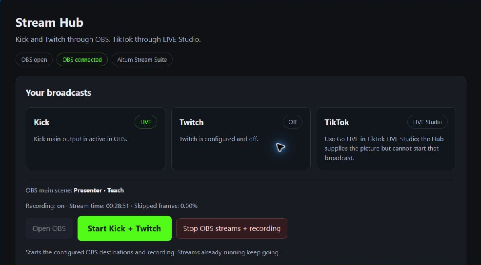

# Streams and shorts: the daily shorts lane

*Case study, Creation. Source is private. Everything here runs locally on my own machine, so there is no public demo. Figures measured or read from project records on 2026-11-21; test counts are the last recorded runs, with their dates.*

> In creation, I have the daily shorts lane where I've made a live presenter. And clip up streams that I do on TikTok.
>
> *Spoken, 2026-11-21.*

## In plain language

I stream live and I teach classes over Zoom. The daily shorts lane is the set of tools around that: a presenter I built to run my slides, a control panel that starts my streams, and a pipeline that cuts a long stream recording into short vertical clips for review. The rule across all of it is the same: nothing goes public without a person approving the exact thing that will be posted.

## The parts

| Part | What it does | Built with | Status, 2026-11-21 |
|---|---|---|---|
| **Live Presenter** | Runs Markdown slide decks from a private desk and shows a clean audience window over Zoom, or a stage in OBS | Node 24 with no npm dependencies, plain browser JS, server-sent events | **Running.** My class tool since 2026-11-02. |
| **The Board** | A hand-drawn-style teaching board inside Live Presenter, with a voice-following live whiteboard | SVG, browser speech recognition, an optional Claude Haiku matcher | **Built and used.** Not verified in real OBS. |
| **Presenter plugin** | Lets an AI assistant open the presenter, make and switch decks, and open Studio projects | MCP server (stdio), zod, esbuild | **Built**, version 0.1.0-beta.2. Not installed or published. |
| **Stream Hub** | One local page that starts and stops my streams and recording in OBS | Node, obs-websocket, Aitum Stream Suite, Windows DPAPI | **Running** since 2026-09-28 |
| **Clip pipeline** | Turns a stream recording into short vertical captioned clips and a review page | faster-whisper, Node, ffmpeg 8.1 with libass, Claude workflow agents | **Proven on one stream** (2026-09-29). The automated, scheduled version is not built. |
| **Live & Clips** | The local studio hub where clips are reviewed, approved and uploaded | Node, a Python worker, YouTube Data API v3 | **Running.** Automatic publishing is off. |
| **Stream analytics** | Imports Twitch, Kick and TikTok exports and lines them up with the recording | Node | **Built.** Two stream sessions imported. |
| **Shorts Studio** | Makes faceless 45 to 60 second Shorts for my book series | Node, ffmpeg, a canon gate | **Built.** 9 episodes uploaded. See [Production studio](production-studio.md#a-shorts-pipeline). |

## Live Presenter

I pick a saved deck, practise from a private desk that shows my notes, then share only the window called "Live Presenter · Audience" in Zoom or another meeting. The same app can also feed OBS as a wide (1920×1080) or tall (1080×1920) stage, with Teach, Demo, Talk and Headset layouts.

- **Decks are plain Markdown.** A `#` or `##` heading, or a line with only `---`, starts a new slide. HTML comments and paragraphs that start with `Note:` become private desk notes and never reach the audience.
- **Private stays private.** The server listens on 127.0.0.1 only. API calls need a desk token made fresh at each launch, and the stage uses a separate read-only key. The stage feed carries the slide, never the notes.
- **It does not take over the meeting.** Practice and Present do not join meetings, turn on the camera or microphone, start screen sharing or start broadcasts. OBS control is used for scene setup only.
- **Line-by-line reveals.** Decks have no built-in reveal. I get the effect with cumulative slides: the same heading, one more line on each slide. A written skill holds this recipe so decks come out the same way every time. On the Board, letters are written out progressively.
- **Text size.** Slides only shrink to fit: the base size is 52 px and it can drop to 0.6 of that. There is no large-print mode.

The same deck format is used for the decks of my public AI classes and a consulting talk.

### The Board

A teaching board for streams and classes: marker-style lines, doodles drawn stroke by stroke, a sticky note for a verse, a banner and a footer. A "show" is a folder with a `show.json` file in a frozen format. Only items marked approved, with no validation problems, can reach the stage, and the server enforces that for clicks, keys and speech alike. In "follow my voice" mode an approved card appears when I say its trigger words. An optional "Meaning" matcher (Claude Haiku, with my own key) can match ideas rather than exact words; the stage never receives the key, the transcript or the prompt. A public-domain Bible text pack (World English Bible) is bundled.

What a show contains is prepared and approved in a separate project and exported in that show format. Live Presenter only decides how it looks.

### The plugin and its Studio tools

The presenter is also packaged as an agent plugin: a stdio MCP server with 10 tools.

| Presenter tools | Studio tools |
|---|---|
| open_presenter, list_presentations, create_presentation, select_presentation, change_slide, get_audience_view | open_studio, list_projects, create_project, open_project |

The Studio tools talk to the separately running Live & Clips hub and return links to a project's recording and clip workspaces. A build script bundles the server with esbuild and copies an allowlist of app files into a versioned folder, and a Python script zips it. The manifest says the tools do not start broadcasts, record, clip media, join meetings or publish.

## Stream Hub



*A runtime check from 2026-10-26: Kick is live, Twitch is configured and off, and TikTok runs through TikTok LIVE Studio, which the Hub cannot start.*

One page on 127.0.0.1 that drives OBS. Kick runs on the main output, Twitch as a Stream Suite output, and TikTok through TikTok LIVE Studio, which I start by hand. Each destination reports one of six states: live, off, connecting, needs setup, manual or unknown. An accepted command without an active output shows as "connecting", not "live".

- **Preflight first.** If setup is missing, the whole start is blocked.
- **Ordered start and stop.** Start goes Kick, then Twitch, then recording. Stop goes the other way, and Kick keeps running if another stream has not confirmed it stopped, because they share one encoder.
- **Keys stay on the machine.** Stream keys are encrypted with Windows DPAPI and never appear in status responses.
- **17 mocked tests** cover order, preflight, reconnecting states, vendor failures, manual destinations and secret-free responses. They never touch a real broadcast.

Live Presenter's broadcast panel reaches the Hub through a small bridge that exposes only status, start and stop, and it masks stream addresses in anything it shows.

## From stream to clips

```
OBS recording ──> move with SHA-256 check ──> transcript (faster-whisper base.en)
      ──> highlight finders, then three judges ──> picks re-transcribed (medium.en)
      ──> cuts snapped to real audio dips ──> ffmpeg render 1080×1920, burned captions
      ──> verify (ffprobe, EBU R128 loudness, contact sheets) ──> local review page
      ──> approval ──> upload
```

1. **Capture.** OBS records each stream. A script moves the file to the media drive and checks its SHA-256 before deleting the original.
2. **Transcript.** faster-whisper (base.en, with voice detection) writes the full transcript. The chosen windows are transcribed again with the larger medium.en model and compared word by word.
3. **Selection.** A Claude workflow runs one finder per 10-minute window, removes duplicates, then puts each candidate through three separate judges: a stranger test (does it stand alone?), the lane rules, and clip craft. The rules keep out business talk, private information and other people's faces or words without consent.
4. **Cuts.** Every cut snaps to a real dip in the audio, not to the transcript's word timings.
5. **Render.** ffmpeg makes a 1080×1920 clip: a square crop around me over a blurred fill, captions burned in with libass, a high-pass filter and compressor, then a limiter at 4× the sample rate so peaks between samples are caught. The target is -14 LUFS.
6. **Review and publish.** A local HTML page shows the clips. Uploading happens in Live & Clips, behind its approval gate.

**The proof run**, on a 98-minute stream recorded on 2026-09-28: 11,921 words transcribed, 28 candidates, 25 after removing duplicates, 13 passed the rules, 11 held back because another person appears in them, and 6 rendered. The six clips run 18 to 42 seconds at 1080×1920, between -13.8 and -14.4 LUFS, with true peaks at or below -1.9 dB. They were checked with ffprobe, loudness measurement, contact sheets and the caption text on screen. I have not yet picked which of them to post.

**TikTok.** I stream live on TikTok through TikTok LIVE Studio, and its exports feed the stream analytics. No code posts clips to TikTok. The plan records why: posts from an unaudited TikTok API app can only be private, so the choices are posting by hand or using an outside service.

## Live & Clips: the approval gate

Live & Clips is the local hub where recordings and clips are reviewed. It has a projects home (each project with its own recordings, clips and playlists), a review gate for clips, a full-talk view with chapters and a searchable transcript, a notebook, and a planner for future streams by topic. It binds to 127.0.0.1 and serves only the files a project names.

- **Approval seals the exact clip.** At approval time it records the video's SHA-256 hash and size, the title and the caption. An upload is refused if any of these changed, if the decision changed, or if the clip runs past the recording's marked public end.
- **Upload is its own button.** It asks for visibility (private, unlisted or public) and an explicit made-for-kids answer, and sends one approved clip at a time to my YouTube channel.
- **Automatic publishing is off by default**, and turning it on does not send older approvals.
- **Sign-in tokens** are encrypted with Windows DPAPI.

From one recorded talk, 5 clips are public on YouTube, per the project's own records; I did not re-check the count on YouTube for this page. 99 tests passed on 2026-11-09 (recorded in its README).

## Where the safety lives in the code

Three excerpts, verbatim.

**1. Cuts land in real silence.** `tools/clip-lib.mjs`, lines 89 to 95, in the streaming lane. Whisper's word timings drift, so a cut placed on them can clip a syllable. This looks at the actual audio levels just before the first word and starts the clip in the quietest stretch.

```js
// Clip start before `w` (keeps up to 0.05 s of the quiet before the word).
export function snapIn(wav, ws, w) {
  const e = levels(wav, Math.max(0, w.start - 0.35), w.start + 0.1);
  if (!e.length) return +w.start.toFixed(2);
  const { m, b } = quietRun(e);
  return +Math.max(e[m].t, e[b].t - 0.05).toFixed(2);
}
```

**2. A stop never pulls the shared encoder from under a stream.** `stream-hub/stream-controller.mjs`, lines 163 to 167, in Stream Hub. Kick, Twitch and TikTok share one encoder, so if any other stream has not confirmed that it stopped, Kick and the recording keep running. (The upload approval check in Live & Clips is shown on the [Kingdom Within](kingdom-within.md#where-the-safety-lives-in-the-code) page.)

```js
        if (['live', 'connecting'].includes(current.view.destinations.twitch.state)
          || (current.view.tiktokMode === 'rtmp' && ['live', 'connecting'].includes(current.view.destinations.tiktok.state))
          || !current.inventory.ok || stoppedChecks < Math.min(2, pollAttempts)) {
          return { lines: [...notes, 'Kick and recording were kept running because an additional stream has not confirmed it stopped.', ...report(current.view)], status: current.view };
        }
```

**3. The deck format.** `src/slides.mjs`, lines 128 to 135, in Live Presenter. A lone `---` or a heading starts a slide, and a note written on a separator stays with the slide before it, so private notes never land on the wrong slide.

```js
    if (/^\s*---\s*$/.test(line.text)) {
      // A comment on a slide separator belongs to the slide before it.
      if (line.notes.length) current.push({ ...line, text: '' });
      flush();
    } else {
      if (/^ {0,3}#{1,2}\s+/.test(line.text)) flush();
      current.push(line);
    }
```

## By the numbers

| What | Value |
|---|---|
| Live Presenter | 33 source files (6,364 lines), 30 browser files (4,006 lines), 73 test files (10,580 lines); 465 tests passing, 0 failing on 2026-11-02 |
| Presenter plugin | 10 tools; server 3 files, 437 lines |
| Stream Hub | 6 files, 1,089 lines; 17 mocked tests |
| Clip pipeline | 8 files, 753 lines |
| Live & Clips | 25 backend files (4,869 lines), 17 browser files (2,414 lines); 99 tests passing on 2026-11-09 |
| Shorts Studio | 22 code files, 1,411 lines; 9 episodes uploaded 2026-09-25 to 2026-10-23 |
| Proof run | 28 candidates to 6 clips, 18 to 42 s, -13.8 to -14.4 LUFS |

Line counts are raw (`wc -l`) and include comments and blank lines; Shorts Studio counts its 22 tracked code files. I did not re-run the test suites for this page; the counts are the last recorded runs.

## Limits

- **No line-by-line reveal feature.** Reveals are cumulative slides. Slides shrink to fit but never grow.
- **No TikTok posting code.** Streams go live on TikTok through LIVE Studio, started by hand; any clip posted there is posted by hand.
- **The clip pipeline has run on one stream.** The scheduled, multi-platform version is not built, and the six proof clips have not been picked.
- **Not verified on hardware.** The Board in real OBS, tall-canvas scene control and the headset mirror have not been verified on hardware. Today I present through the direct audience window.
- **The plugin is a beta.** It is built and packaged, not installed or published. Its manifest says it never starts a broadcast; the bundled app includes the broadcast panel, which can ask Stream Hub to start or stop.
- **Recent presenter work is uncommitted.** Practice and Present, saved presentations, analytics, the broadcast panel, drawing stages and the plugin are on disk in the working copy but not yet in a commit.
- **No live links.** Every tool here is local-only, and the channels are not linked from this page.

## Related

[Production studio](production-studio.md) · [Three Mountaintops](three-mountaintops-world.md) · [Build method](build-method.md)
