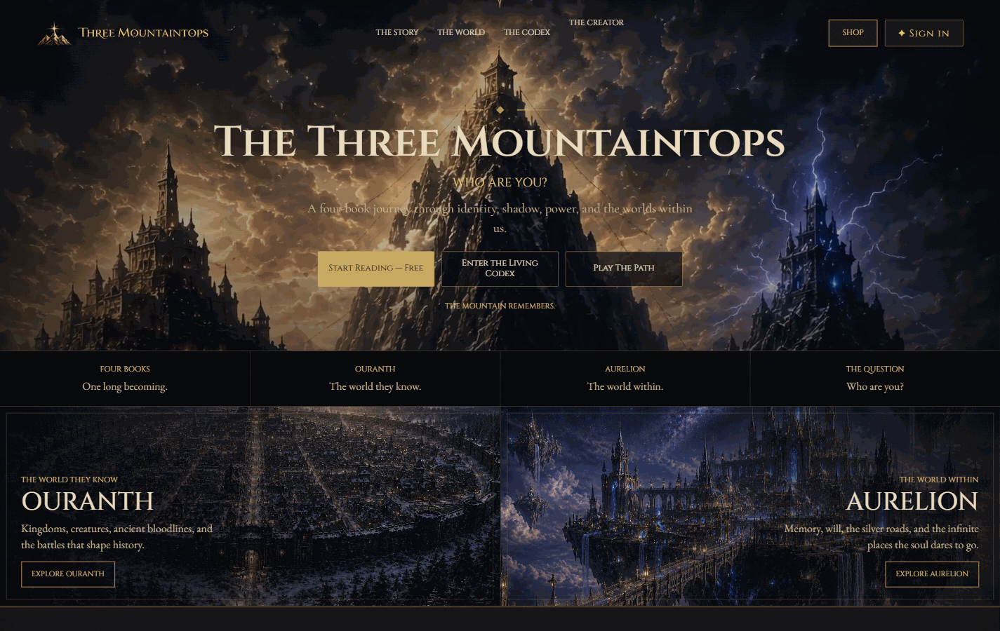
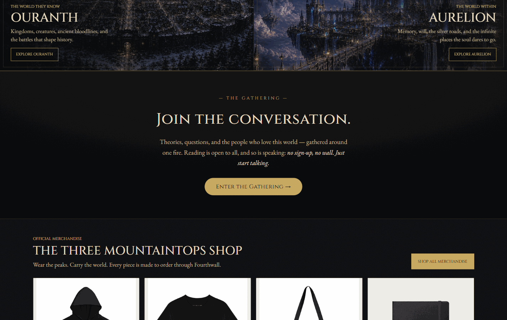
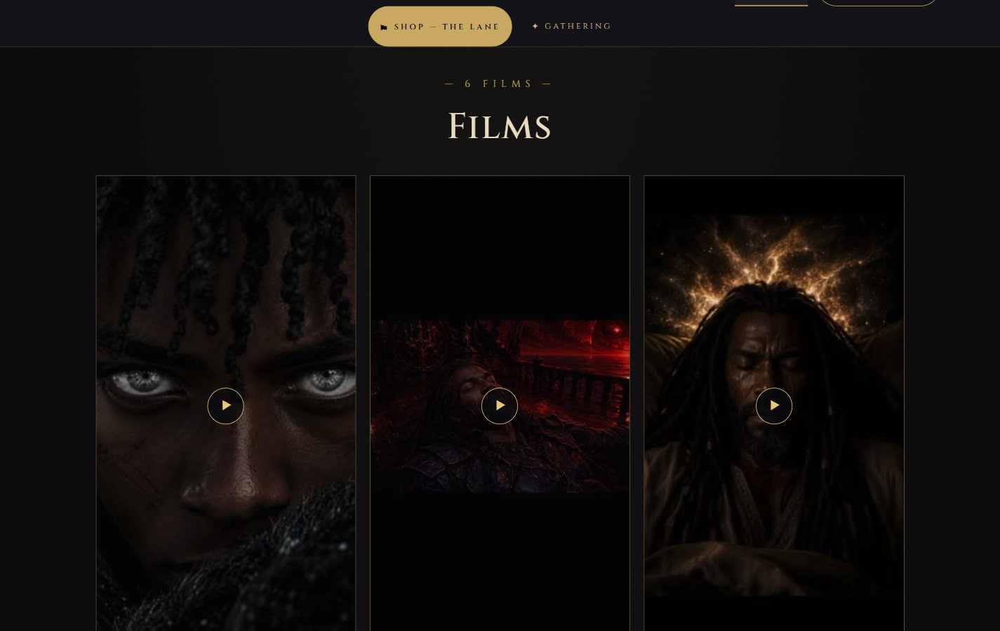
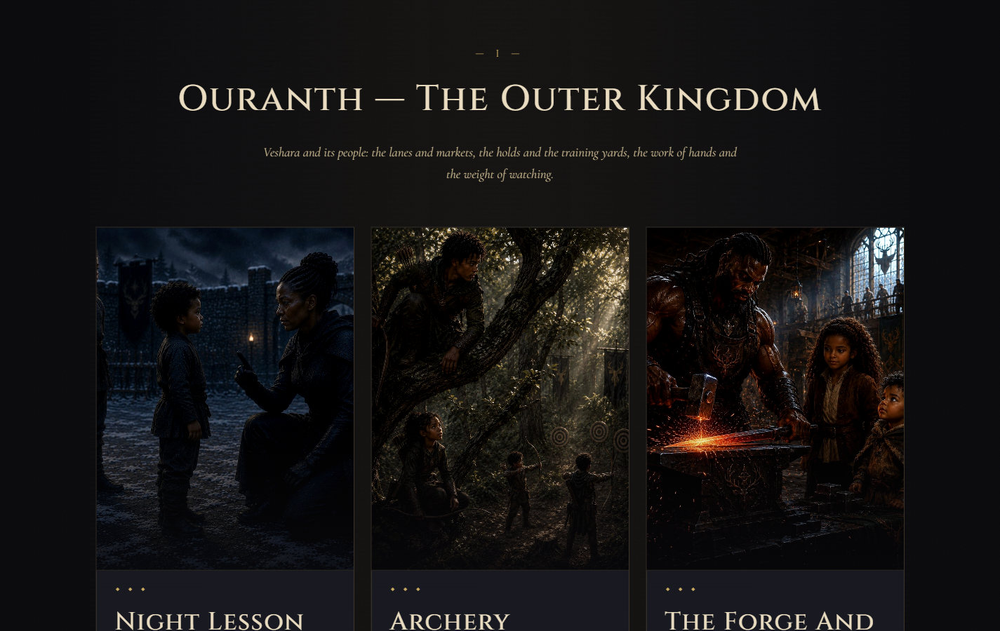
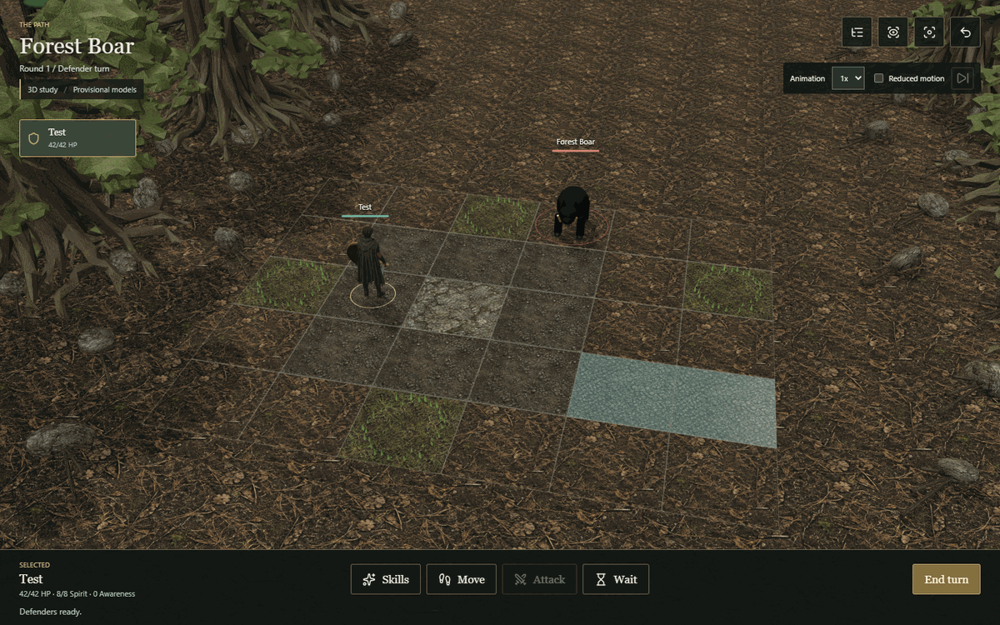
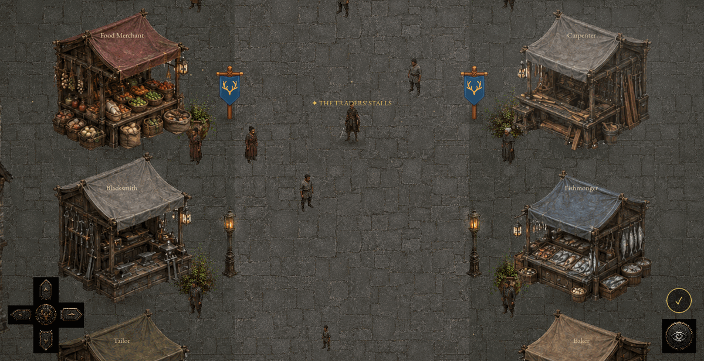
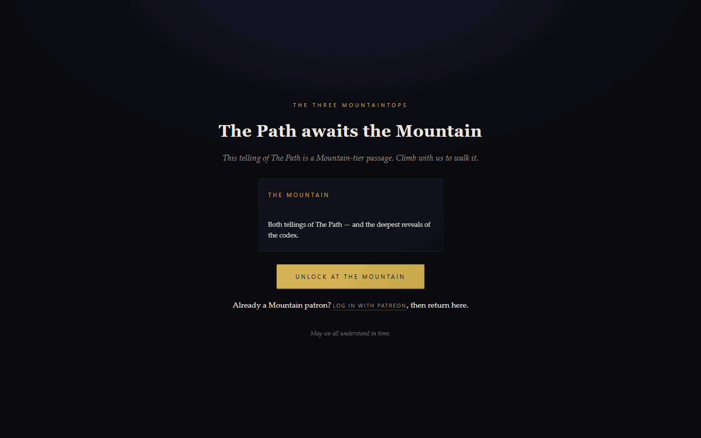
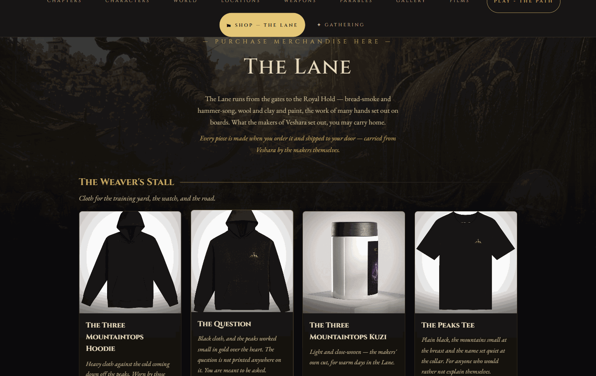
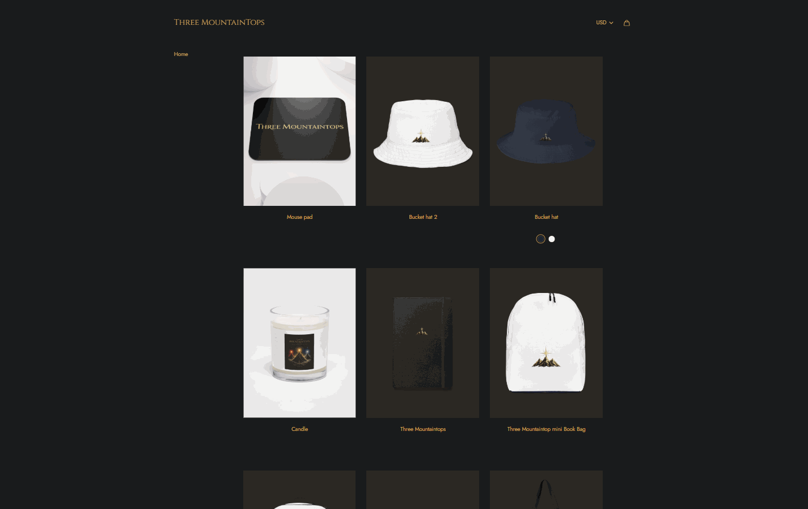

# Three Mountaintops: the platform I built

*Case study. Live: [threemountaintops.world](https://threemountaintops.world). The game: [path.threemountaintops.world](https://path.threemountaintops.world) (member-gated). Merch: [the Fourthwall store](https://three-mountaintops-shop.fourthwall.com). Source is private. Figures measured 2026-11-21. This page covers the platform, not the story: I write every word of the books myself, and nothing here describes their content beyond what the public homepage already shows.*

> my own platform I made. Complete with merch sales. That I built myself.
>
> *Spoken, 2026-11-21.*

> Write FOUR books ingrained with my own personal spiritual concepts — showcased through symbolism and allegory — and launch my own platform where people enjoy my creation, with picture visuals and community.
>
> *The north star of my Creative mountain, in my own words, set 2026-07-14.*

The book series shares its name with my [north star](north-star.md). It is the project that lives on the Creative mountain.



## In plain language

The Three Mountaintops is a four-book series. In the homepage's words: "A four-book journey through identity, shadow, power, and the worlds within us."

Around the books I built the place where readers meet them: a reading site and living codex of the world, an open discussion hub, films, an art gallery, a game, a member portal and a merch shop. Two parts run on outside services: **Patreon** takes membership payments and sign-in, and **Fourthwall** handles merch checkout and makes each piece to order. The rest is mine: the site, the forum, the game, the member gate, the lore chat, the posting engine and the studio that makes the art and films.

## The parts

| Part | What it does | Built with | Status, 2026-11-21 |
|---|---|---|---|
| **Living Codex** (the site) | Reading, plus a codex of the world: chapters, characters, world, locations, weapons, parables, gallery, films | Static HTML, JS and CSS with a Node build step, on Vercel; serverless functions for sign-in and the codex | **Live.** The codex is in open mode: public except entries marked early access. |
| **The Gathering** (discussion hub) | Theories and questions about the world. The site says reading and posting need no sign-up | Supabase Postgres, row-level security on every table | **Built**, live since 2026-08-20. On 2026-11-21 it did **not load** for visitors: its database backend was unreachable. |
| **Films** | 6 public films: the series in sixty seconds, then one film each for Chapters One to Five | Made in [the Studio](production-studio.md), listed in the site's public trailer data | **Live**, public |
| **Gallery** | 325 art entries in 5 sections, each with a title and a type (scene, character, location, creature, weapon) | Filed and published through the studio's sorter | **Live**, public |
| **The Path** (the game) | Walk the kingdom of Veshara; tactical grid combat | Godot 4.6 web export; a Three.js combat renderer; a Vercel Edge gate | **Member-gated** (top Patreon tier). A free public beta ran 2026-09-10 to 2026-10-16 and has ended. |
| **Member portal and lore chat** | Patreon sign-in, one signed cookie shared across the platform's subdomains, and a lore chat whose retrieval index is filtered by the member's tier | Vercel functions and Vercel Blob; OpenAI embeddings for retrieval, the Anthropic API for answers | **Member-gated** |
| **The Lane** and the store | The merch shop, written in the world's voice: 15 products in 5 "stalls" on the site; 21 products on the Fourthwall store | Site section that links each product to Fourthwall for checkout | **Live**, public |
| **Campaign engine** | Drafts a post per platform each day into an approval queue, checks drafts against the canon, syncs merch from Fourthwall, and builds Meta ads paused | Express 4 and node-cron, a Render web service; a separate private repository | **Built.** Bluesky auto-posts only when armed; everything else waits for review. Live state not re-checked for this page. |
| **The Studio** | Where the art and trailers are made | Local Node server, ffmpeg, Blender scripts | **Built, local-only.** See [Production studio](production-studio.md). |

## How it fits together

```
                       threemountaintops.world  (Living Codex, Vercel)
         reading . codex . gallery . films . the Lane . the Gathering
              ^                 ^               |                |
              |                 |               v                v
   Studio (local) ----> art and films     Fourthwall store   forum database
                                          (checkout)         (row-level security)

   Patreon sign-in --> member portal --> signed cookie for the platform's subdomains
                              |                         |
                              v                         v
                  lore chat (tier-filtered)     The Path: Godot web build;
                                                an Edge gate checks the cookie

   Campaign engine (Render): daily drafts --> approval queue;  Fourthwall --> merch posts
```

## The Gathering: the hub

> Theories, questions, and the people who love this world — gathered around one fire. Reading is open to all, and so is speaking: no sign-up, no wall. Just start talking.
>
> *The homepage, public.*



The forum has boards, threads, replies, votes and reports. Sign-in is optional, by an email magic link; a visitor can post as a "Wanderer" without one. The database enforces ownership: row-level security is on for every table in the schema (the 6 forum tables and one more), people can change or delete only their own rows (staff can override), and a policy blocks replies to locked threads.

**Honest status:** on 2026-11-21 the forum body showed "Couldn't load the Gathering" for visitors, because its database backend could not be reached. The code and schema are built; the service needs restoring. Threads tied to codex entries ("Discuss this") are **not built**: the schema has a column ready for it and no code uses it yet.

## Films and gallery



The Films hub lists 6 public films with no lock on any of them: "The Three Mountaintops" (the series in sixty seconds), then one film each for Chapters One to Five. They are made in [the Studio](production-studio.md) and published through the site's public trailer list.



The gallery shows 325 art entries in 5 sections, with a search box. The images and their titles are public.

## The Path: the game



*Development capture, 2026-09-26. The corner label says "3D study / Provisional models"; this is work in progress, not final art.*



*Development capture, 2026-09-06, cropped to keep story text out.*


*Painted environment, 2026-10-11, cropped to keep story text out.*

The site's game page says it changes every week. The code record is slower: the last published release in the repository is from 2026-09-14, and the last game commit is from 2026-10-15.

- **Engine:** Godot 4.6 with a web export. 254 GDScript files, 39,385 lines; 38 scenes; 396 commits.
- **Tests:** 103 test files with 2,732 assertions. I did not run them for this page (Godot is not installed on the machine I measured from).
- **Combat:** a separate Three.js renderer. The Godot game opens it through its JavaScript bridge. 130 files and 14,676 lines including the Blender Python; its 18-file Node suite ran 161 tests, all passing, on 2026-11-21.
- **Release:** a packager records a SHA-256 hash for every runtime file in a release manifest. The large game data file is served from Vercel Blob. 24 release tests, all passing.
- **The gate:** Vercel Edge middleware checks the signed session cookie (HMAC-SHA-256) on every route of the game host and lets only the top tier through; everyone else is redirected to a locked page. It fails open by design: if its secret is missing or it hits an error, it lets the request through, so it can never break the deploy. On 2026-11-21 it was on and redirecting logged-out visitors.



*What a logged-out visitor sees today. The price line is hidden in this capture.*

## Membership, plainly

The books are open on purpose. In my words: "the books in the site that anyone that comes to my live site can review it. And anyone that is on the Patreon can still subscribe, but for this live site, I want to have people come to it so that they can come into the Gathering Hub" (2026-11-21). Today 6 chapters are free to read and 1 is in patron early access.

Membership is optional and runs through Patreon, in tiers. The site's gate page names the top tier, **The Mountain**: "Both tellings of The Path — and the deepest reveals of the codex." A 7-day reading trial is built but not offered today. I do not list prices here.

## The Lane: merch



The shop is written in the world's voice: 15 products in 5 stalls (Weaver's, Potter's, Packmaker's, Scrivener's, Limner's), each with its own description and a "Take it home" button that goes to Fourthwall. The Fourthwall store holds 21 products: hoodies, tees, hats, totes, book bags, mugs, a candle, a notebook, a mouse pad and art pieces. I built the site, the shop section and the product sync; the checkout is Fourthwall's.



*Prices hidden in this capture.*

## The campaign engine: posting without losing control

A separate service drafts one post per platform each day and puts the drafts in an approval queue. A canon check reads each draft; by its own design that check fails open, so it advises and a person decides. Only Bluesky can post on its own, and only when three switches are all on (the engine is armed, Bluesky autopost is enabled, and a live connector exists). Everything else is review-first.

- **Merch sync:** pages through Fourthwall's product list with a 50-page ceiling against runaway paging, then drafts posts for the products.
- **Ads:** every Meta campaign, ad set and ad is created **paused**. Only the armed scheduler path can switch them on, and the account spending cap is written and read back first. A rehearsal mode builds the real objects and leaves them paused.
- 13 connector files for social platforms, a newsletter, Patreon and video. 103 tests across merch, ads and connectors, all passing. 282 commits.

## Where the safety lives in the code

Three excerpts, verbatim. None of them contains story text.

**1. One tier gate, failing safe.** `three-mountaintops-patreon/api/_lore-gate.js`, lines 12 to 29. Production and the test use the same pure function. A piece of lore with no tier counts as the highest tier, so a tagging mistake hides lore instead of leaking it.

```js
export const TIER_RANK = { none: -1, public: 0, seed: 1, tree: 2, mountain: 3 };

export function tierRank(tier) {
  const r = TIER_RANK[tier];
  return typeof r === "number" ? r : -1;
}

// FAIL-SAFE: a chunk with no minTier is treated as the MOST sensitive (mountain),
// so a mis-tagged or pre-tagging chunk is withheld rather than leaked.
export function chunkAllowed(chunk, viewerTier) {
  const min = (chunk && chunk.minTier) || "mountain";
  return tierRank(viewerTier) >= tierRank(min);
}

export function filterChunksByTier(chunks, viewerTier) {
  if (!Array.isArray(chunks)) return [];
  return chunks.filter((c) => chunkAllowed(c, viewerTier));
}
```

The lore chat filters its retrieval index with this before it ranks anything by similarity. The lowest member tier cannot use the chat, and the top tier has a monthly call cap.

**2. The build refuses to write a leaky index.** `scripts/build-lore-index.mjs`, lines 238 to 254. The search index is split into chunks, and a chunk can cross a chapter boundary. The build recomputes each chunk's tier from every chapter it spans and records a violation if the chunk is tagged less strictly than its strictest chapter. Any violation stops the build before the index is written.

```js
    var span = gk.chapterSpan && gk.chapterSpan.length ? gk.chapterSpan : [gk.chapter];
    var reqTier = WORLD_BIBLE_MIN_TIER, reqRank = -1, driving = null;
    for (var s = 0; s < span.length; s++) {
      var sEntry = chaptersByManuscript[span[s]];
      var sTier = sEntry ? effectiveRequiredTier(sEntry, codexConfig, now) : WORLD_BIBLE_MIN_TIER;
      var sRank = rankOf(sTier, codexConfig);
      if (sRank > reqRank) { reqRank = sRank; reqTier = sTier; driving = span[s]; }
    }
    if (rankOf(gk.minTier, codexConfig) < reqRank) {
      guardViolations.push("chunk " + gk.id + " (spans manuscript chapters [" + span.join(",") + "]) tagged '" + gk.minTier + "' is LESS restrictive than its span's most-restrictive tier '" + reqTier + "' (chapter " + driving + ") — boundary spillover leak");
    }
    // Provenance: a chunk whose entire span is public must be stamped public (catches
    // "flipped a chapter public on the site but forgot to rebuild the index").
    if (reqTier === "public" && gk.minTier !== "public") {
      guardViolations.push("chunk " + gk.id + " (spans chapters [" + span.join(",") + "], all public) is stamped '" + gk.minTier + "', not 'public' — stale or over-gated index");
    }
  }
```

Chunks are content-hashed, so unchanged text reuses its embedding. The index is bundled with the chat function and read from disk; it is not served to the public.

**3. Locked entries ship only a teaser.** `three-mountaintops/lib/redact.mjs`, lines 49 to 67. The static build and the signed-in API share this function. A locked chapter keeps its teaser fields and schedule; a locked world entry ships nothing but a spoiler-safe teaser the author wrote. The site deploys only the redacted build output.

```js
  if (!unlocked) {
    out.locked = true;
    if (def.kind === 'chapter') {
      // Early-access teaser: chapters are summaries, not secret lore — keep the
      // marketing hook and schedule, withhold only the deep `sections`.
      out.role = entry.role;
      out.trait = entry.trait;
      out.tags = entry.tags || [];
      out.status = entry.status;
      out.tierRequired = entry.tierRequired;
      out.wordCount = entry.wordCount;
      out.releaseDate = entry.releaseDate;
    } else if (entry.teaser) {
      // World-bible: role/trait can themselves be spoilers, so we ship nothing
      // but an explicit, author-written spoiler-safe teaser when provided.
      out.teaser = entry.teaser;
    }
    return out;
  }
```

## By the numbers

| What | Value |
|---|---|
| Main repository (private) | 878 commits on the working branch, 891 across all branches, 2026-05-20 to 2026-11-20 |
| The Path | 254 GDScript files, 39,385 lines, 38 scenes, 396 commits |
| Combat renderer | 130 files, 38 commits; 161 Node tests passing |
| Game release gate | 31 files, 44 commits; 24 tests passing |
| Living Codex site | 114 commits; about 6,900 lines of site code |
| Member portal | 102 commits |
| Gate tests (in the main repository) | 3 tier-gating tests for the portal's lore gate and 5 beta-window tests for the game gate and site, all passing |
| Lore index pipeline | 4 scripts, 564 lines |
| Database schema | 6 forum tables plus 1 more, all with row-level security |
| Campaign engine (separate private repository) | 282 commits; 103 tests passing |
| Public content | 6 films, 325 gallery entries, 6 free chapters and 1 in early access, 15 products on the site, 21 on the store |

Tests marked "passing" were run on 2026-11-21. The 103 Godot test files were counted, not run.

## Limits

- **The Gathering is down for visitors today.** It is built and was live; its backend needs restoring before I call it live again.
- **No free way into the game right now.** The public beta ended on 2026-10-16. I have not shown gameplay from the live member build; the game images above are development captures.
- **The redaction guarantee covers text only.** I do not claim it for images.
- **The game gate covers the game host's routes.** I do not claim more than that, and it fails open if its secret is missing.
- **The canon check on post drafts is advisory.** It fails open by design, which is why drafts wait for a person. The one exception is Bluesky when it is armed.
- **"Discuss this" threads are not built.**
- **The Godot tests were not run for this page**, and the campaign engine's live state was not re-checked.

## Related

[Production studio](production-studio.md) · [The North Star](north-star.md) · [Authors Codex](authors-codex.md) · [Build method](build-method.md)

*Footer line of the site: "May we all understand in time."*
