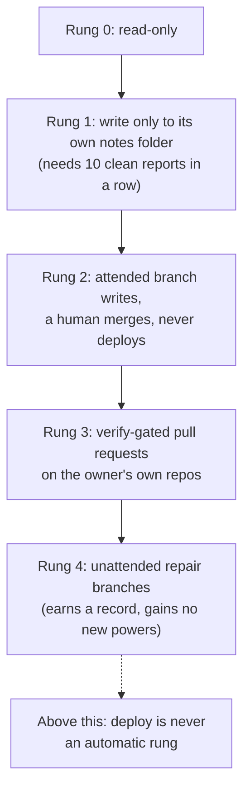

# The Understudy: an AI agent that has to earn every permission

*Case study. The tooling is private; numbers were recomputed on 2026-11-20 from its own ledgers and test runs.*

## In plain language

Understudy is the name of my AI consulting and build studio, and of the idea behind it: an agent that *learns a job and then runs it*.

The hard part of that sentence is "then runs it". A fluent agent that invents a fact is worse than no agent, and one person cannot watch many agents all day. So the Understudy starts with almost no power (it can only **read**), and every extra power has to be **earned on a record that someone other than the agent has checked**.

Think of an apprentice electrician. They do not wire a panel on day one. They shadow, then assist, then do supervised work, and each step up is signed off by someone who can lose their license if they are wrong. The Understudy works the same way.

## The ladder

## How it works

- **The sweep** runs every 6 hours, one project per run. The model is given only `Read`, `Glob` and `Grep`. The other tools are *removed* from the run (not merely forbidden in a prompt), and anything else is denied by permission mode.
- **The citation harness** opens every file and line the agent cites and checks the quote. **One bad citation rejects the whole report.** A report that quotes a secret is rejected and the secret is never echoed.
- **A second agent adjudicates**, as a skeptic. It only *proposes* a verdict. A clean verdict can be recorded automatically; a false or unclear one is held for me. The rule, written in the ledger code: *the Understudy never writes its own verdict.*
- **Verdicts move the count.** Clean advances it, false resets it to zero, neutral (a fault in the checker, not the agent) does neither.
- **Writes are revert-protected.** Before any attended write, a wrapper refuses a dirty repo and tags the clean state; a pre-push hook blocks every push unless I override it. What it does *not* cover (push, deploy) is written at the top of the file, which is why that run is attended.
- **Unattended repair** gets its own rung: the model can only Read and Edit; a wrapper owns git and tests and never merges or pushes.
- **Personas are data.** Three role-defined agents, each with a home folder, an owner-set North Star and a directive in my own words. The file states the rule: *a persona never invents, infers or makes up its own directive.*

## By the numbers

| What | Value | Source |
|---|---|---|
| Sweep reports since 2026-07-09 | 208 events: **186 accepted, 22 rejected** by the harness (about 10.6%) | sweep log |
| Adjudications | 150: **147 clean, 2 neutral, 1 "learned", 0 false** | trust ledger |
| Citation-harness tests | **12 of 12 pass** | run on 2026-11-20 |
| Tooling size | 4,784 lines of Python and PowerShell | `wc -l` |
| Current rung | **2** | ledger |

Two caveats I will not hide:

- **"0 false" means no confirmed-false finding was found. It does not mean zero errors.** 22 reports were thrown out by the harness before they ever got that far.
- **Rung 2 was granted by me, not earned.** The ledger says so (`basis: owner-grant`, real progress 2 of 10). The counter had stalled for 19 days with nine improvement tickets waiting, so I granted it on the record and labelled it as granted. Rung 1 was earned honestly (25 clean reports against a bar of 10).

## Decisions and why

| Decision | Why |
|---|---|
| Remove tools instead of forbidding them | A prompt is not a boundary; a missing tool cannot be talked into use. |
| The agent never scores itself | A grader that is also the student drifts. |
| Make writes reversible, keep irreversible actions structurally shut | Mistakes become lessons instead of incidents. |
| Give unattended work its own rung | It can earn a track record without gaining new powers. |
| Label granted rungs as granted | A ledger that cannot be trusted is worse than none. |

## Related

- [Agent runtime](agent-runtime.md): how the same "agents are data, the loop is fixed" idea is built for paying tenants.
- [Engineering stories](engineering-stories.md): how the citation harness was loosened without letting a fabrication through.
